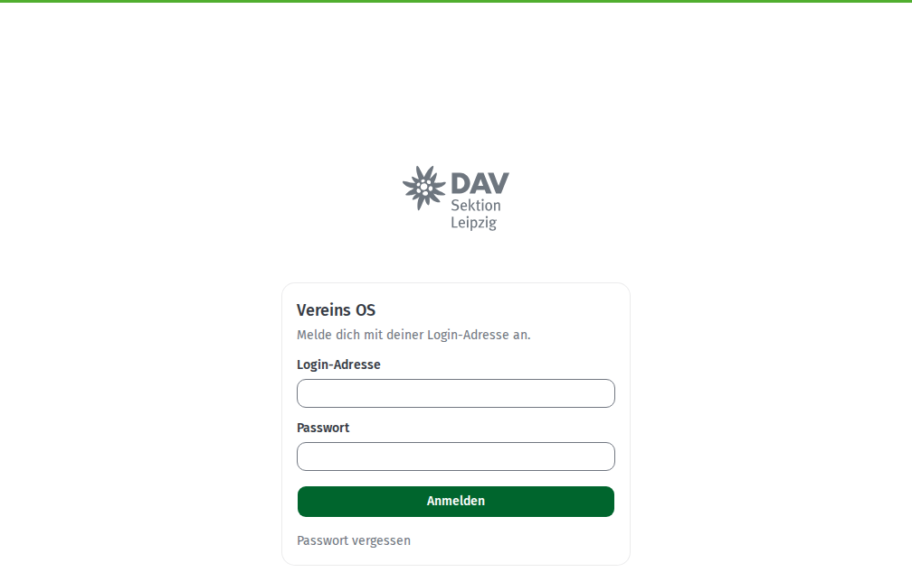
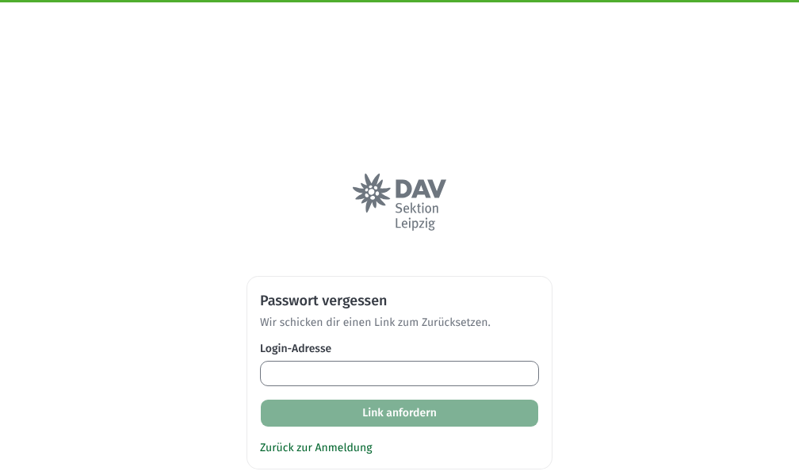
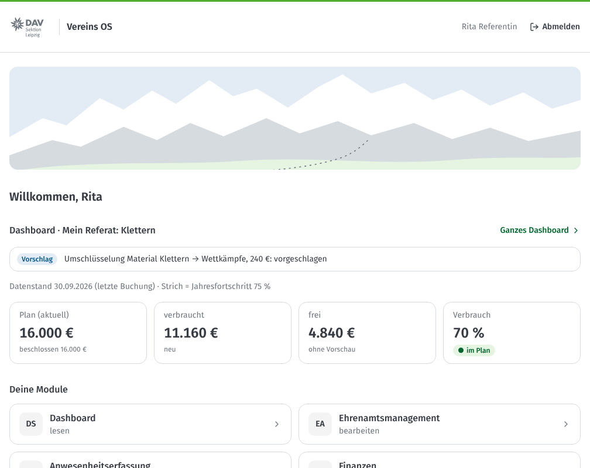
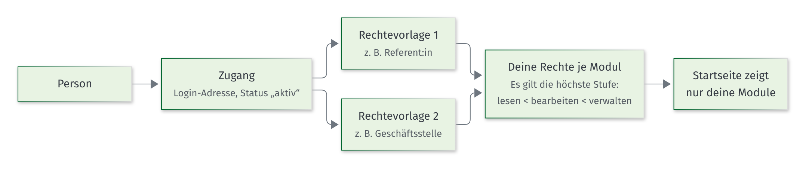

# Erste Schritte

Für alle, die einen Zugang zum Vereins OS haben.

[Zurück zur Übersicht](README.md)

## Was du brauchst

- eine Login-Adresse der Sektion (endet auf **@dav-leipzig.de**)
- eine Einladung vom Admin
- einen Computer oder ein Handy mit Internet

Du kannst das Vereins OS im Browser nutzen, auch auf dem Handy. Eine App musst du nicht installieren.

## Vom Anlegen bis zur ersten Anmeldung

## Einladung annehmen und Passwort setzen

1. Du bekommst eine E-Mail mit einer Einladung zum Vereins OS.
2. Klicke auf den Link in der E-Mail.
3. Wähle ein Passwort mit **mindestens 8 Zeichen**.
4. Gib das Passwort ein zweites Mal ein.
5. Klicke auf **„Zugang aktivieren“**.

Jetzt ist dein Zugang aktiv. Du landest auf deiner Startseite.

> **Gut zu wissen:** Der Link in der E-Mail gilt nur eine begrenzte Zeit. Ist er abgelaufen, bitte den Admin um eine neue Einladung.

## Anmelden

1. Öffne das Vereins OS im Browser.
2. Gib deine **Login-Adresse** ein.
3. Gib dein **Passwort** ein.
4. Klicke auf **„Anmelden“**.

## Passwort vergessen

1. Klicke auf der Anmeldeseite auf **„Passwort vergessen“**.
2. Gib deine Login-Adresse ein.
3. Klicke auf **„Link anfordern“**.
4. Du bekommst eine E-Mail. Klicke auf den Link.
5. Wähle ein neues Passwort und klicke auf **„Passwort speichern“**.

## Die Startseite

Auf der Startseite siehst du **deine Module**. Das sind nur die Module, für die du Rechte hast. Unter dem Namen steht, was du dort darfst:

- **lesen:** Du kannst Daten ansehen.
- **bearbeiten:** Du kannst Daten ansehen und ändern.
- **verwalten:** Du kannst alles in diesem Modul, auch löschen und Einstellungen ändern.

Klicke auf eine Kachel, um das Modul zu öffnen.

Hast du Rechte auf das **Dashboard**, siehst du über deinen Modulen gleich das Wichtigste: was **zu tun** ist und das **Budget deines Referats** (bzw. des Vereins). Mit **„Ganzes Dashboard“** öffnest du alles. Mehr dazu im Abschnitt [Dashboard](02-referentinnen.md#dashboard-budget-meines-referats).

Oben im Modul siehst du eine Leiste mit den Seiten des Moduls. Oben links kommst du mit einem Klick auf **„Vereins OS“** zurück zur Startseite.

### Woher kommen meine Rechte?

Rechte vergibt immer der Admin. Ein Amt bringt nicht automatisch Rechte mit. Du brauchst mehr Rechte? Sprich den Admin an.

## Abmelden

Klicke oben rechts auf **„Abmelden“**. Melde dich immer ab, wenn du an einem fremden Computer arbeitest.

## Wenn etwas nicht klappt

| Was passiert? | Was du tun kannst |
|---|---|
| Die Seite zeigt „Kein Zugriff“. | Du hast für diese Seite keine Rechte. Klicke auf „Zur Startseite“. Brauchst du die Seite, frag den Admin. |
| Ein Modul fehlt auf der Startseite. | Du hast dafür keine Rechte oder das Modul ist noch nicht freigeschaltet. |
| Die Anmeldung klappt nicht. | Prüfe die Login-Adresse. Nutze „Passwort vergessen“. Hilft das nicht, ist dein Zugang vielleicht gesperrt: Frag den Admin. |
| Beim Speichern erscheint ein Fehler. | Lies die Meldung. Oft fehlt nur eine Angabe. Sonst versuch es gleich noch einmal. Bleibt der Fehler, schreib der Geschäftsstelle. |

## Wichtige Wörter

| Wort | Bedeutung |
|---|---|
| **Person** | Ein Mensch im Vereins OS, zum Beispiel ein:e Aktive:r, ein Kind in einer Gruppe oder ein Elternteil. Jeder Mensch gibt es nur einmal. |
| **Zugang** | Damit kann sich eine Person anmelden. Die meisten Personen haben keinen Zugang. |
| **Login-Adresse** | Die E-Mail-Adresse, mit der du dich anmeldest (@dav-leipzig.de). |
| **Rechtevorlage** | Ein fertiges Bündel von Rechten, zum Beispiel „Referent:in“ oder „Geschäftsstelle“. |
| **Referat** | Ein Bereich der Sektion, zum Beispiel Klettern oder Kinder und Jugend. Referent:innen sehen die Daten ihres Referats. |
| **Aktive** | Personen, die sich ehrenamtlich engagieren. Sie haben einen Ehrenamtsstatus. |
| **Ehrenamtsstatus** | aktiv, ruhend oder ausgeschieden. |
| **Eigenschaft** | Eine Angabe zu einer Person mit Datum, zum Beispiel Funktion, Lizenz oder Kontaktdaten. |
| **Einsatz** | Ein Training, eine Fahrt, ein Arbeitseinsatz, ein Kurs oder eine Tour. |
| **Abrechnung** | Die Vergütung einer Person für ein Halbjahr, berechnet aus den Einsätzen. |
| **Budgetposten** | Eine Zeile im Finanzplan des Vereins, zum Beispiel „Vergütung Aktive“, mit dem geplanten Betrag. |
| **Gesamtbudget** | Mehrere Budgetposten zusammen, zum Beispiel alle Posten von Kinder und Jugend. |
| **Datenstand** | Datum der letzten Buchung im DATEV-Export. Bis dahin sind die Zahlen im Dashboard vollständig. |
| **Umschichtung** | Geld zwischen zwei Budgetposten desselben Gesamtbudgets verschieben. Die Summe bleibt gleich. |
| **Umschlüsselung** | Eine Buchung einem anderen Budgetposten zuordnen. |
