# Anleitung für Referent:innen

Für Referent:innen und Hüttenwart:innen mit der Rechtevorlage „Referent:in“.

[Zurück zur Übersicht](README.md) · Zuerst lesen: [Erste Schritte](01-erste-schritte.md)

## Was du siehst

Du siehst die Daten **deines Referats**. Hast du mehrere Referate, siehst du alle davon. Welche Referate das sind, legt der Admin fest.

| Modul | Was du dort tust | Stand |
|---|---|---|
| Dashboard | Budget deines Referats sehen, Hinweise eintragen, Umschichtungen beantragen | freigeschaltet |
| Ehrenamtsmanagement | Aktive deines Referats finden, anlegen und pflegen | freigeschaltet |
| Anwesenheitserfassung | Trainings, Fahrten und andere Einsätze deines Referats erfassen | freigeschaltet |
| Finanzen | Abrechnungen deines Referats als „sachlich richtig“ bestätigen | freigeschaltet (für Kinder und Jugend und Leistungssport) |
| Planungshilfe Touren und Kurse | Touren und Kurse deines Referats planen, einreichen und freigeben | freigeschaltet (Referate Touren und Ausbildung) |

---

## Dashboard: Budget meines Referats

*Die Bilder zeigen erfundene Testdaten.*

Im Dashboard siehst du, wie viel Geld dein Referat im Jahr hat und wie viel schon ausgegeben ist. Du musst nicht mehr nachfragen.

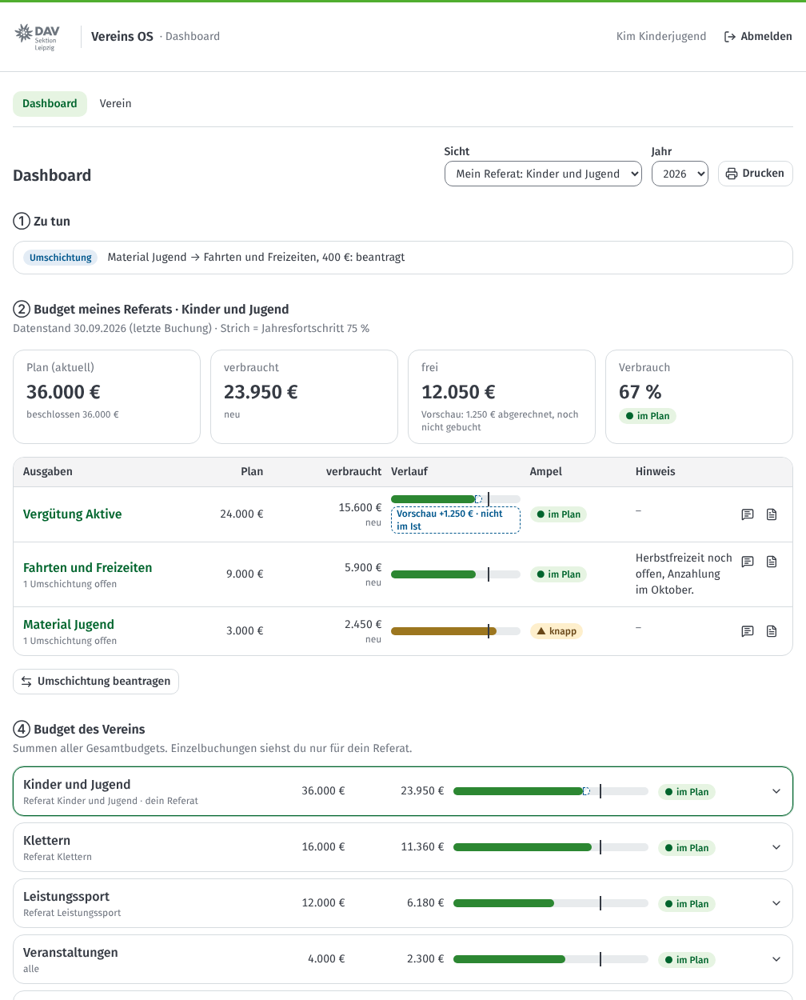

Oben wählst du die **Sicht** (dein Referat oder „Verein“) und das **Jahr** (laufendes Jahr oder Vorjahr). Die Seite hat drei Blöcke:

- **① Zu tun:** was gerade ansteht, zum Beispiel Abrechnungen zur Bestätigung oder die Antwort auf deinen Antrag.
- **② Budget meines Referats:** die Kacheln **Plan**, **verbraucht**, **frei** und **Verbrauch**, darunter eine Zeile je Budgetposten.
- **④ Budget des Vereins:** die Summen aller Gesamtbudgets. Dein Referat ist grün umrandet. Klicke auf ein Gesamtbudget, um seine Posten zu sehen.

So liest du eine Zeile:

| Teil | Bedeutung |
|---|---|
| **Plan** | aktueller Plan. Steht darunter „beschlossen“, wurde umgeschichtet. |
| **verbraucht** | gebuchte Ausgaben bis zum **Datenstand** (letzte Buchung im DATEV-Export, nicht heute). Darunter der Wert des Vorjahres am gleichen Tag; „neu“ heißt: im Vorjahr gab es den Posten nicht. |
| **Balken** | grün, gelb oder rot gefüllt bis zum Verbrauch. Der **senkrechte Strich** zeigt, wie viel vom Jahr bis zum Datenstand vorbei ist. Liegt der Balken rechts vom Strich, gibst du schneller aus als geplant. |
| **Vorschau** (blau gestreift) | Vergütung, die schon ausgezahlt, aber noch nicht gebucht ist. Sie zählt **nicht** zu verbraucht, frei oder zur Ampel. |
| **Ampel** | ● im Plan (unter 80 %), ▲ knapp (80 bis 100 %), ■ über Plan (über 100 %) oder ohne Budget |
| **Hinweis** | kurzer Text deines Referats, zum Beispiel „Herbstfreizeit noch offen“ |
| **?** | Die Zuordnung ist noch unsicher. Die Budgetpflege klärt das. |

Auf dem Handy stehen die Kacheln und Posten untereinander.

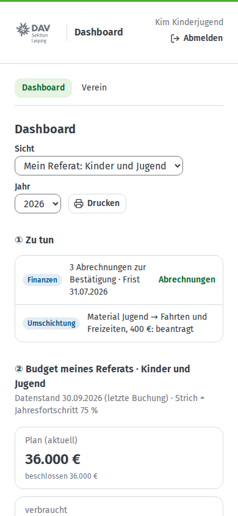

### Einzelbuchungen ansehen

Klicke auf einen Budgetposten. Du siehst die Summe je Konto und alle Buchungen. Du kannst sie durchsuchen und nach Datum, Konto oder Betrag sortieren.

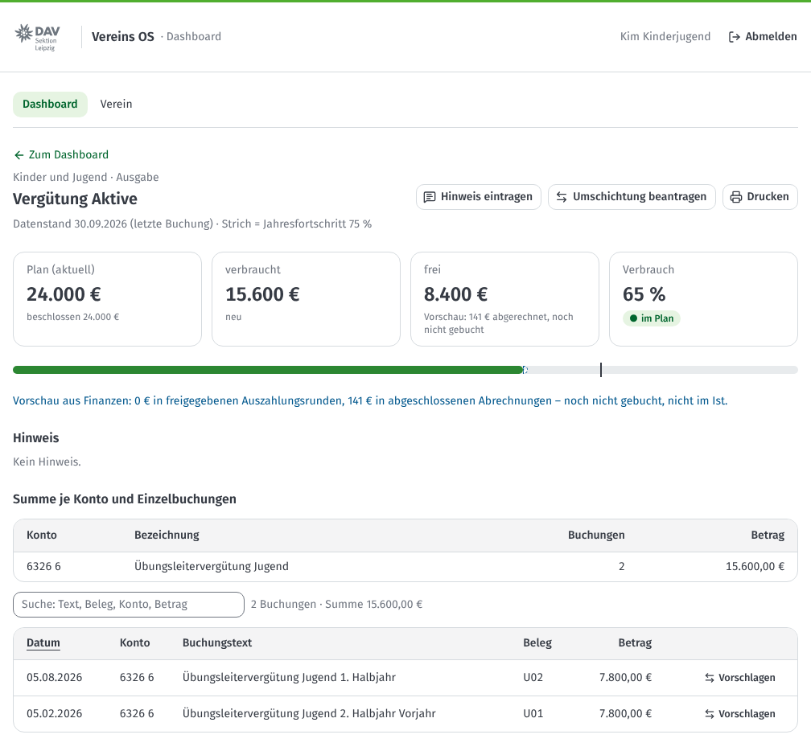

Einzelbuchungen siehst du nur für dein Referat und für Gesamtbudgets, die für alle freigegeben sind (zum Beispiel Veranstaltungen). Bei anderen Referaten siehst du nur die Summen.

### Hinweis eintragen

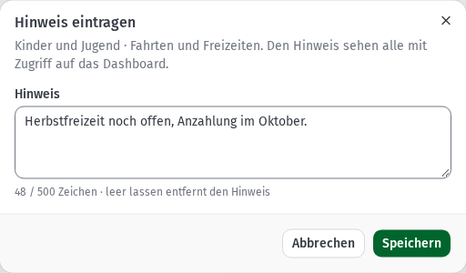

1. Klicke in der Zeile auf das Sprechblasen-Zeichen oder im Budgetposten auf **„Hinweis eintragen“**.
2. Schreib höchstens 500 Zeichen und klicke auf **„Speichern“**.

Den Hinweis sehen alle mit Zugriff auf das Dashboard. Ein leerer Hinweis entfernt ihn.

### Umschichtung beantragen

Du brauchst bei einem Posten mehr Geld und hast bei einem anderen Posten **desselben Gesamtbudgets** zu viel? Dann beantrage eine Umschichtung. Die Summe deines Gesamtbudgets bleibt gleich.

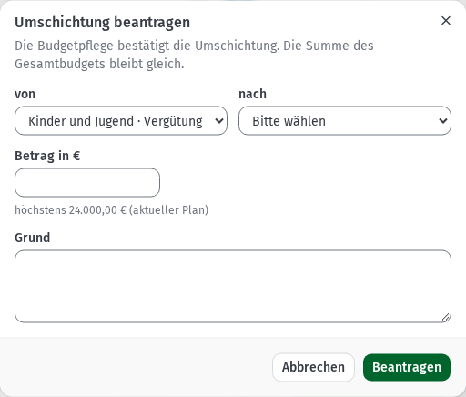

1. Klicke auf **„Umschichtung beantragen“**.
2. Wähle **von** und **nach**, trage den **Betrag** und einen **Grund** ein.
3. Klicke auf **„Beantragen“**.

Die Budgetpflege bestätigt oder lehnt ab. Die Antwort siehst du unter „Zu tun“. Bis dahin kannst du den Antrag zurückziehen.

### Umschlüsselung vorschlagen

Eine Buchung steht beim falschen Budgetposten? Klicke im Budgetposten bei der Buchung auf **„Vorschlagen“**, wähle den richtigen Posten und schreib einen Grund. Die Budgetpflege entscheidet. Bis dahin steht bei der Buchung „Vorschlag offen“.

### Drucken

**„Drucken“** erzeugt eine Seite im Querformat mit allen Gesamtbudgets aufgeklappt, mit Datenstand und Druckdatum. Gut für Sitzungen.

---

## Ehrenamtsmanagement

Hier findest du alle Aktiven deines Referats mit ihren Funktionen, Ämtern, Lizenzen und Qualifikationen.

### Aktive finden

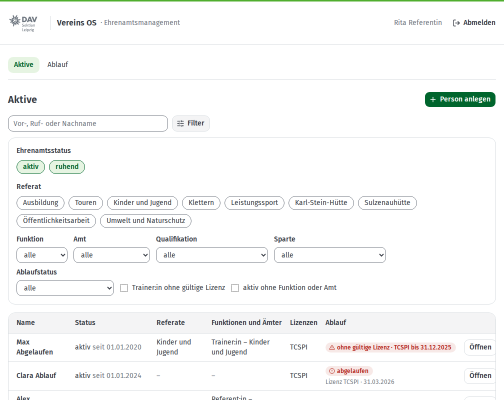

1. Öffne auf der Startseite **„Ehrenamtsmanagement“**. Du landest bei **„Aktive“**.
2. Gib in **„Suche“** einen Vor-, Ruf- oder Nachnamen ein.
3. Im Kasten **„Filter“** grenzt du die Liste ein, zum Beispiel nach **Funktion** „Trainer:in“, nach einer **Qualifikation** oder nach dem **Ablaufstatus**. Mit **„Filter zurücksetzen“** im selben Kasten siehst du wieder alle.
4. Klicke auf einen Namen, um die Person zu öffnen.

In der Spalte **„Lizenzen“** steht das rote Kennzeichen **„ohne gültige Lizenz“**, wenn jemand die Funktion Trainer:in hat, aber keine gültige Lizenz. Die Spalte **„Ablauf“** zeigt, ob etwas abgelaufen ist oder bald abläuft.

> **Gut zu wissen:** Du siehst nur Personen mit dem Status „aktiv“ oder „ruhend“, die eine Funktion oder ein Amt in deinem Referat haben.

### Eine Person ansehen

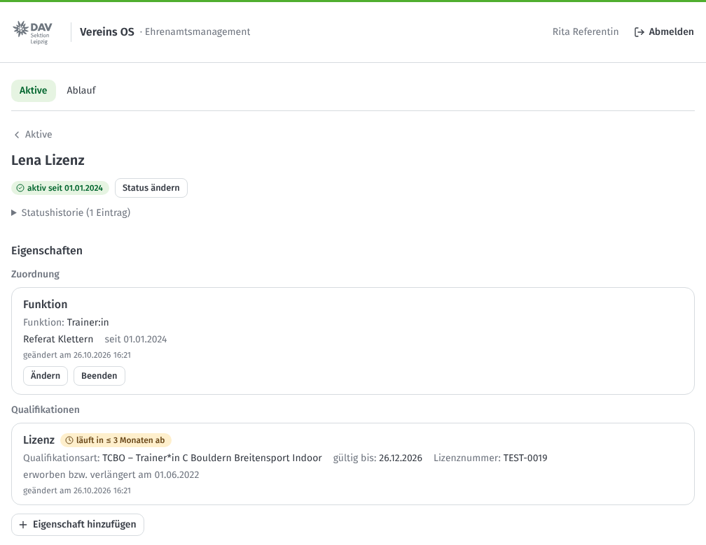

Oben steht der **Ehrenamtsstatus**. Darunter stehen die **Eigenschaften**, sortiert nach Bereichen, zum Beispiel „Zuordnung“ (Funktion, Amt) und „Qualifikationen“ (Lizenzen).

Bei jeder Eigenschaft gibt es Knöpfe:

- **„Ändern“:** einen Fehler korrigieren.
- **„Beenden“:** Die Angabe gilt ab einem Datum nicht mehr, zum Beispiel wenn jemand keine Trainer:in mehr ist. Sie bleibt in der Historie sichtbar.
- **„Verlängern“** (nur bei Lizenzen und Qualifikationen): eine neue Gültigkeit eintragen.

Mit **„Eigenschaft hinzufügen“** trägst du etwas Neues ein, zum Beispiel eine Lizenz oder eine Funktion.

### Eine Person anlegen

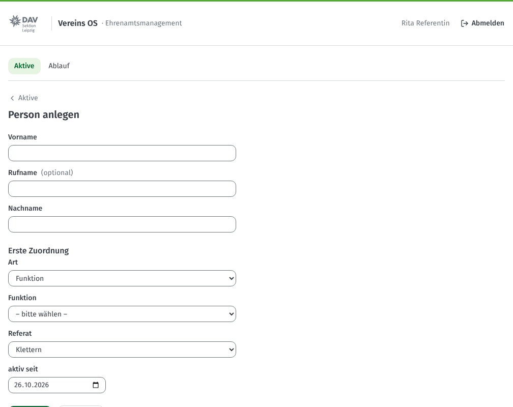

1. Klicke in **„Aktive“** auf **„Person anlegen“**.
2. Trage **Vorname** und **Nachname** ein. Den **Rufnamen** nur, wenn die Person anders genannt wird.
3. Wähle die **erste Zuordnung**: eine Funktion (zum Beispiel Trainer:in) oder ein Amt in deinem Referat. Das ist für dich Pflicht.
4. Trage ein, **seit wann** die Person aktiv ist.
5. Klicke auf **„Speichern“**.

> **Gut zu wissen:** Gibt es schon eine Person mit ähnlichem Namen, zeigt das Vereins OS eine Warnung. Prüfe die Treffer. Ist es dieselbe Person, lege sie **nicht** neu an. War sie ausgeschieden, kannst du sie über die Warnung wieder aktiv setzen.

### Lizenz verlängern

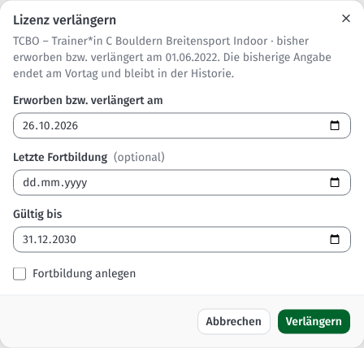

1. Öffne die Person.
2. Klicke bei der Lizenz auf **„Verlängern“**.
3. Trage ein, **wann** die Lizenz verlängert wurde und **bis wann** sie gilt.
4. Klicke auf **„Verlängern“**.

Die alte Angabe bleibt in der Historie.

### Ehrenamtsstatus ändern

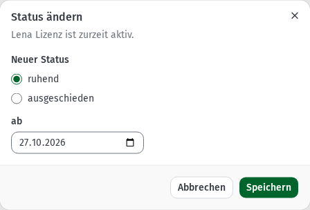

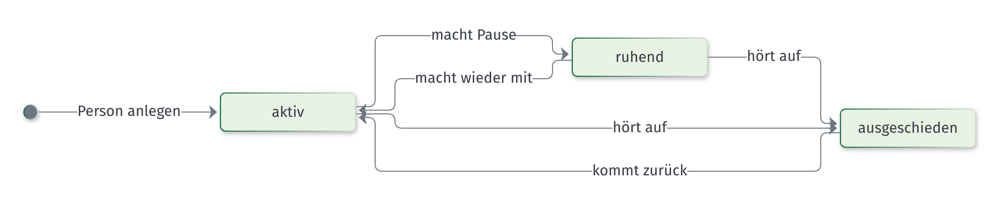

1. Öffne die Person.
2. Klicke auf **„Status ändern“**.
3. Wähle den neuen Status und **ab wann** er gilt.
4. Klicke auf **„Speichern“**.

Der Status gilt für die ganze Person, auch in anderen Referaten. Ausgeschiedene Personen siehst du danach nicht mehr in deiner Liste.

### Welche Lizenzen laufen ab?

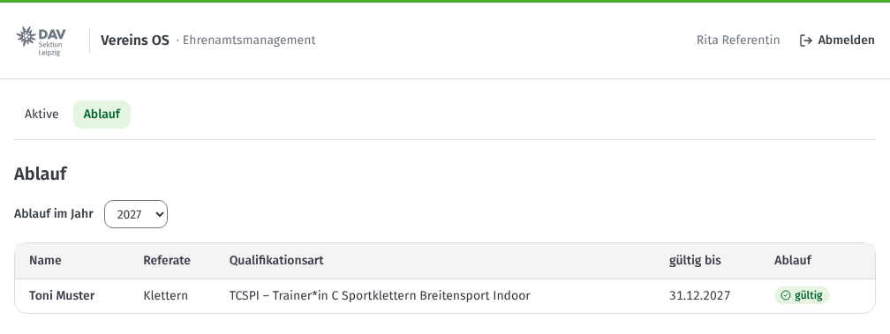

1. Klicke oben auf **„Ablauf“**.
2. Wähle das **Jahr**.
3. Du siehst, wessen Lizenz oder Qualifikation in diesem Jahr abläuft.
4. Mit **„CSV exportieren“** lädst du die Liste herunter, zum Beispiel für Excel.

In der Liste „Aktive“ und auf der Detailseite siehst du außerdem Hinweise wie „läuft in ≤ 3 Monaten ab“.

---

## Anwesenheitserfassung

Hier erfasst du, wer bei einem Training, einer Fahrt oder einem anderen Einsatz dabei war. Daraus berechnet die Geschäftsstelle später die Vergütung.

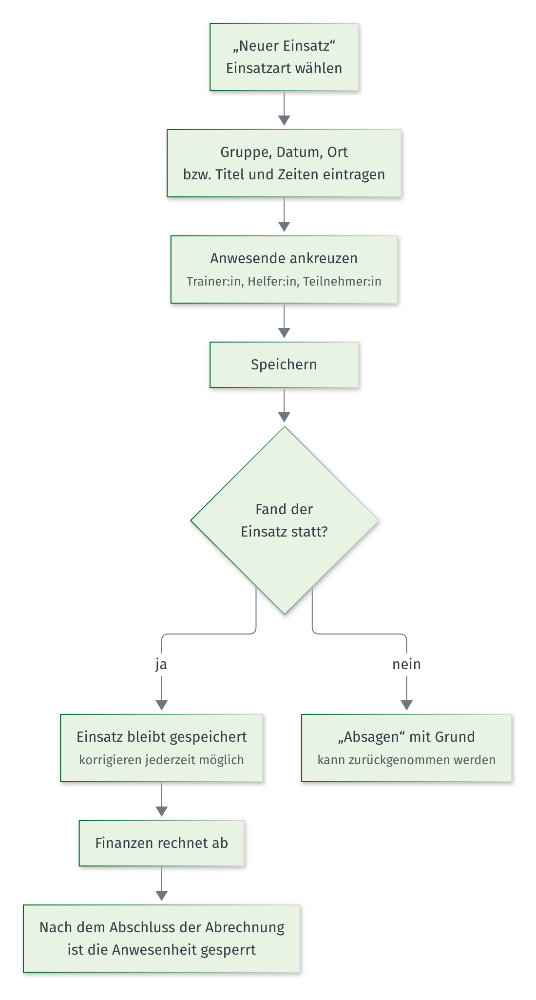

### Einsätze ansehen

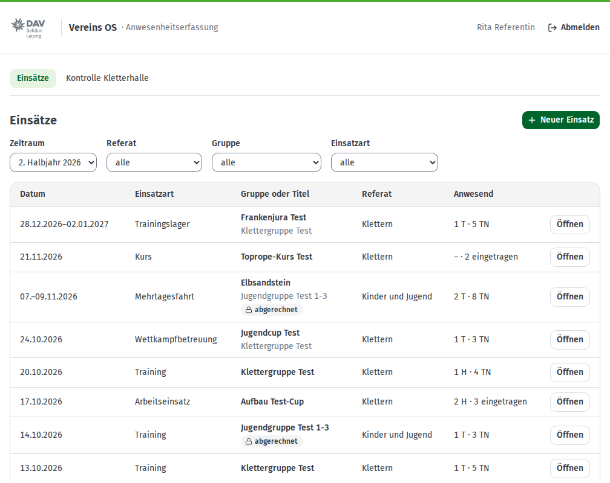

Du siehst die Einsätze deines Referats. Oben wählst du **Zeitraum**, **Gruppe** und **Einsatzart**. In der Spalte **„Anwesend“** steht kurz, wer da war: **T** = Trainer:in, **H** = Helfer:in, **TN** = Teilnehmer:in.

Mit **„Öffnen“** siehst du einen Einsatz mit allen Anwesenden.

### Ein Training erfassen

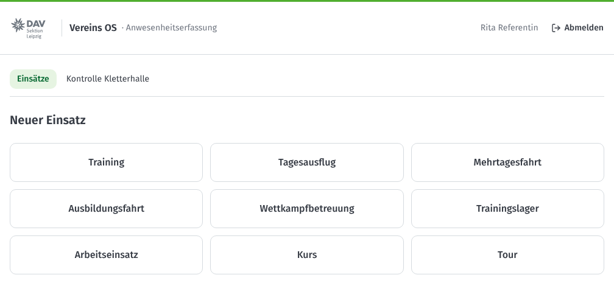

1. Klicke auf **„Neuer Einsatz“**.
2. Wähle **„Training“**.
3. Wähle die **Gruppe** und das **Datum**. Die Trainingszeit der Gruppe erscheint darunter.
4. Wähle den **Ort**.
5. Unter **„Anwesenheit“** erscheinen die Trainer:innen, Helfer:innen und Teilnehmer:innen der Gruppe. **Kreuze an, wer da war.** Bei Trainer:innen und Helfer:innen wählst du die Rolle.
6. War eine Vertretung da? Klicke auf **„Person hinzufügen“** und suche sie.
7. Kam ein Kind zum Probetraining? Klicke auf **„Probetraining hinzufügen“** und trage nur den **Vornamen** ein.
8. Klicke auf **„Speichern“**.

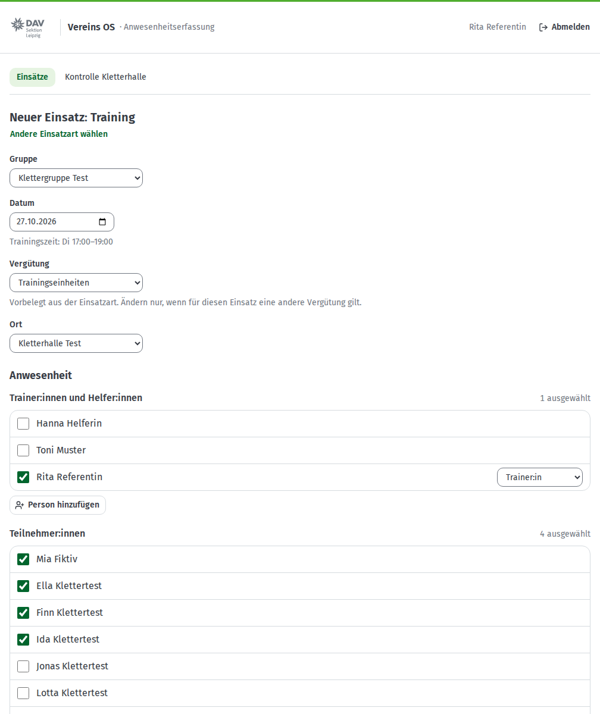

> **Gut zu wissen:** Erfasse nur Trainings, die stattgefunden haben. In den Ferien erfasst du einfach nichts. Schreib in die **Bemerkung** keine Angaben zur Gesundheit von Kindern.

Das geht auch gut auf dem Handy, direkt in der Halle:

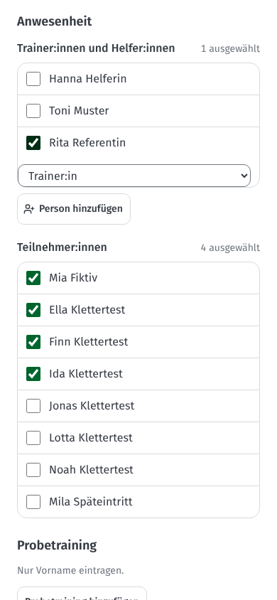

### Andere Einsätze

Bei den anderen Einsatzarten ist der Ablauf gleich: Einsatzart wählen, Angaben eintragen, Anwesende ankreuzen, speichern.

| Einsatzart | Was du zusätzlich einträgst |
|---|---|
| Tagesausflug, Ausbildungsfahrt, Wettkampfbetreuung (ein Tag) | Titel, organisierende Person, Datum, Dauer unter oder mindestens 8 Stunden |
| Mehrtagesfahrt, Trainingslager, mehrtägige Fahrt | Titel, organisierende Person, Start und Ende mit Uhrzeit (ab bzw. bis Startort) |
| Arbeitseinsatz | Titel und Datum; Helfer:innen eintragen und später bestätigen: anwesend oder nicht erschienen. Neue Helfer:innen kannst du gleich als Aktive anlegen. |
| Kurs, Tour | Titel, Datum; nur Trainer:innen und Helfer:innen, keine Teilnehmer:innen |

### Einen Einsatz korrigieren oder absagen

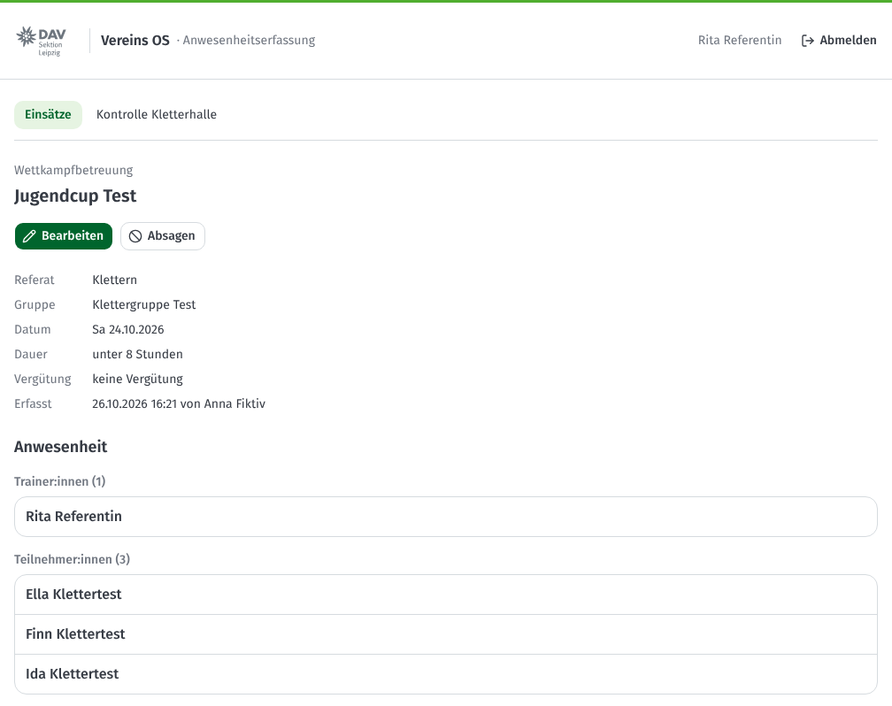

- **„Bearbeiten“:** Datum, Ort oder Anwesenheit korrigieren. Einsatzart und Gruppe kannst du nach dem Speichern nicht mehr ändern. Dann den Einsatz absagen und neu anlegen.
- **„Absagen“:** Der Einsatz fand nicht statt. Gib einen Grund an. Du kannst die Absage später zurücknehmen.
- **Löschen** kann nur die Geschäftsstelle.

> **Gut zu wissen:** Ist die Abrechnung für einen Einsatz abgeschlossen, kannst du die Anwesenheit nicht mehr ändern. Wende dich dann an die Geschäftsstelle.

### Kontrolle Kletterhalle

Unter **„Kontrolle Kletterhalle“** siehst du je Ort und Zeitraum, wie viele Kinder bei jedem Training waren. So kannst du die Abrechnung des Punktekontos der Kletterhalle prüfen.

---

## Finanzen: Abrechnungen bestätigen

*Zuerst für die Referate Kinder und Jugend und Leistungssport.*

Zweimal im Jahr rechnet die Geschäftsstelle die Vergütung der Trainer:innen und Helfer:innen ab. Bevor sie auszahlt, **bestätigst du**, dass die Angaben für dein Referat stimmen. Das heißt **„sachlich richtig“**. So schauen immer zwei Personen auf eine Abrechnung (Vier-Augen-Prinzip).

### So bestätigst du

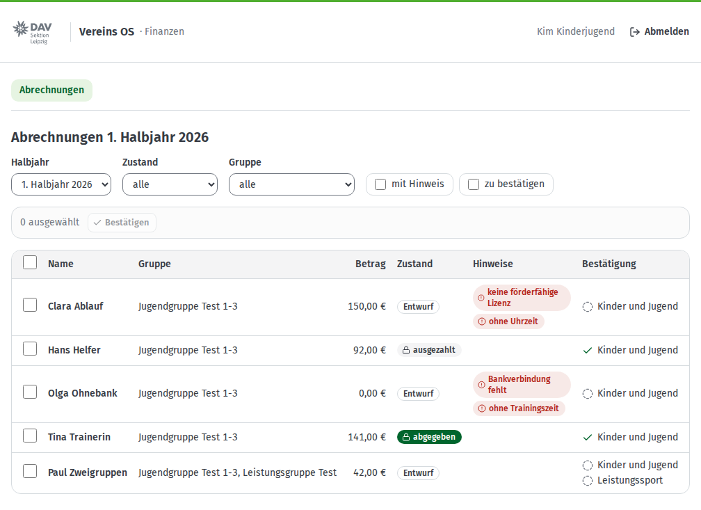

1. Öffne **„Finanzen“**. Du siehst die Abrechnungen des aktuellen Halbjahrs. Wähle oben das **Halbjahr**.
2. Klicke auf einen Namen.
3. Prüfe die **Positionen**: Stimmen Datum, Einsatz und Rolle?
4. Ist alles richtig, klicke auf **„Bestätigen“**.

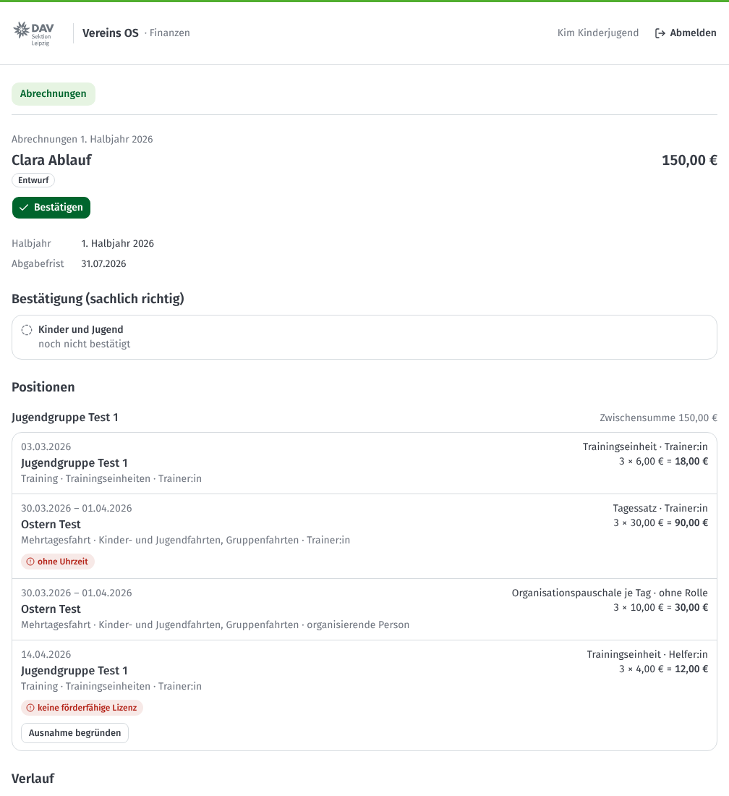

Du siehst nur die Positionen deines Referats. Bankdaten siehst du nicht.

Mehrere Abrechnungen auf einmal: In der Liste die Kästchen vor den Namen ankreuzen und oben auf **„Bestätigen“** klicken.

### Was bedeuten die roten Hinweise?

| Hinweis | Was du tun kannst |
|---|---|
| **keine förderfähige Lizenz** | Die Person hatte am Tag des Einsatzes keine passende gültige Lizenz. Gibt es einen Grund für eine Ausnahme, klicke auf **„Ausnahme begründen“**. |
| **ohne Uhrzeit** / **ohne Trainingszeit** | Es fehlt eine Zeit. Prüfe den Einsatz in der Anwesenheitserfassung oder sprich mit der Geschäftsstelle. |
| **Bankverbindung fehlt**, **Bestätigung steuerfreie Einnahmen fehlt** | Darum kümmert sich die Geschäftsstelle. |

Stimmt etwas nicht? Korrigiere den Einsatz in der Anwesenheitserfassung oder sag der Geschäftsstelle Bescheid. Sie berechnet die Abrechnung dann neu.

---

## Planungshilfe Touren und Kurse

Hier planst du Führungstouren, Kurse und Gemeinschaftstouren. Die Planungshilfe rechnet den Teilnahmebeitrag und die CO2-Bilanz aus und bereitet alles für Yolawo vor. **Touren** gehören zum Referat Touren, **Kurse** zum Referat Ausbildung.

### Eine Planung anlegen

1. Öffne auf der Startseite **„Planungshilfe Touren und Kurse“**. Du siehst die Liste der Planungen.
2. Klicke auf **„Neue Planung“**.
3. Wähle den **Tourtyp**: Führungstour, Kurs oder Gemeinschaftstour. Gib einen **Titel** ein (höchstens 90 Zeichen).
4. Klicke auf **„Planung anlegen“**. Die Planung öffnet sich als **Entwurf**.

> **Tipp:** Eine Tour wiederholt sich? Klicke in der Liste bei einer alten Planung auf **„Kopieren“**. Termin, Anmeldeschluss, Kontaktdaten und Bestätigungen musst du neu eintragen.

### Die Schritte 1 bis 7

Die Planung hat sieben Schritte, wie das bisherige Formular „Tourenkonzept“. Oben siehst du, in welchem Schritt noch Angaben fehlen. Rechts (auf dem Handy unten) steht die **Seitenleiste** mit Beitrag, CO2-Bilanz und Hinweisen.

1. **Leitung:** Suche die Leitung und die Helfer:innen in den Aktiven. Die Planungshilfe zeigt, ob jemand den **Trainersatz** oder den **Helfersatz** bekommt. Das hängt von der Lizenz im Ehrenamtsmanagement ab. Trage für die Leitung E-Mail und Notfallkontakt ein.
2. **Ausschreibung:** Titel, Sportart, Region, Kurzbeschreibung, Titelbild.
3. **Termin & Anreise:** Beginn, Ende, Treffpunkt und die geplante An- und Abreise. Jede Teilstrecke zählt für die CO2-Bilanz.
4. **Anforderungen:** Gehzeit, Höhenmeter, Kondition, Technik, Voraussetzungen, Ausrüstung.
5. **Teilnahme:** Mindest- und Höchstzahl, Anmeldeschluss, Fragen im Anmeldeformular.
6. **Kalkulation:** Tagessätze bzw. Lehreinheiten, Kosten der Leitung, sonstige Kosten, Teilnahmebeitrag. Felder mit **„Vorschlag“** füllt die Planungshilfe aus. Änderst du sie, kannst du mit **„übernehmen“** zum Vorschlag zurück.
7. **Einreichen:** Wer legt das Angebot in Yolawo an? Bestätigungen zu Lizenz, Abrechnung, Übungsleiter-Erklärung und Notfallkarte.

> **Gut zu wissen:** Die Planungshilfe **speichert automatisch** zwei Sekunden nach deiner letzten Eingabe. Oben steht „Gespeichert … Uhr“. Hat jemand anderes die Planung inzwischen geändert, erscheint ein Hinweis mit **„Neu laden“**.

### Externe Leitung anlegen

Ist die Leitung noch nicht in den Aktiven? Klicke in Schritt 1 auf **„Neue Person anlegen“**. Gib Vor- und Nachnamen ein und setze das Häkchen, dass du die Person über die Speicherung ihrer Daten informiert hast. Die Person bekommt zunächst den **Helfersatz**. Den Trainersatz gibt es, sobald die Geschäftsstelle ihre Lizenz im Ehrenamtsmanagement einträgt.

### Einreichen, Rückfrage, Freigabe

1. Klicke auf **„Einreichen“**. Fehlen noch Angaben, zeigt die Planungshilfe eine Liste und öffnet den passenden Schritt.
2. Wer das **Freigaberecht** hat, prüft die Planung. Er oder sie kann eine **„Rückfrage“** stellen oder **„Freigeben“**. Mit der Freigabe bleiben die Sätze so, wie sie an diesem Tag gelten.
3. Nach der Freigabe ändern nur noch Personen mit Freigaberecht oder die Geschäftsstelle.

### In Yolawo anlegen

1. Öffne den Reiter **„Ausgaben“**. Dort stehen das **Yolawo-Eingabeblatt** (jedes Feld mit „Kopieren“), der **Ausschreibungstext** und die **Zusammenfassung**.
2. Lege das Angebot in Yolawo an. Übertrage die Felder einzeln, den Ausschreibungstext mit **„Alles kopieren“**.
3. Wer das Freigaberecht hat, klickt danach auf **„In Yolawo angelegt“** und trägt, wenn gewünscht, Link oder Nummer des Angebots ein. Jetzt entsteht der **Einsatz in der Anwesenheitserfassung**.

> **PDF:** Im Reiter „Ausgaben“ lädst du die ganze Planung mit **„PDF herunterladen“** als Datei herunter.

### Absagen und nach der Tour

- **Absagen:** Klicke auf **„Absagen“** und gib einen Grund ein. Der Einsatz in der Anwesenheitserfassung wird als abgesagt markiert. Sind dort schon Personen als anwesend erfasst, geht das nicht mehr.
- **Nach der Tour:** Klicke auf **„Durchgeführt“**. Die Geschäftsstelle schließt die Planung später ab.
- Kontakt- und Notfalldaten werden **30 Tage nach der Tour** bzw. nach der Absage automatisch gelöscht.

### Kostenauswertung

Klicke oben auf **„Auswertung“**. Du siehst die geplanten Kosten und Beiträge aller Planungen eines Jahres mit Summen. Abgesagte Planungen blendest du mit **„abgesagte anzeigen“** ein.

