# Anleitung für die Geschäftsstelle

Für Mitarbeiter:innen der Geschäftsstelle mit der Rechtevorlage „Geschäftsstelle“.

[Zurück zur Übersicht](README.md) · Zuerst lesen: [Erste Schritte](01-erste-schritte.md)

## Was du siehst

Du darfst in allen Fachmodulen **verwalten**. Das heißt: Du siehst alle Referate und darfst alles ändern. Du siehst auch Angaben, die nur für Geschäftsstelle und Admin bestimmt sind, zum Beispiel Bankverbindung oder Führungszeugnis-Einsicht.

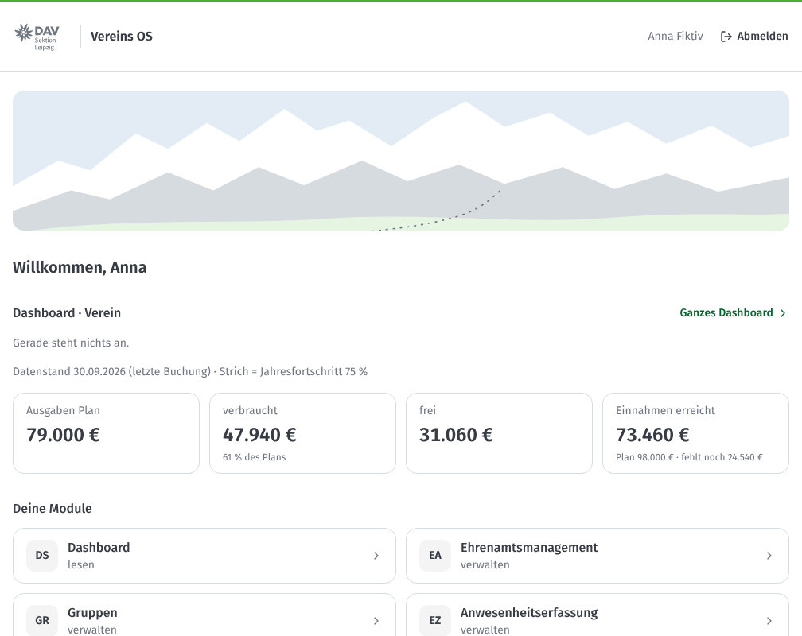

| Modul | Was du dort tust | Stand |
|---|---|---|
| Ehrenamtsmanagement | Aktive aller Referate pflegen, Gremien, Referate, Eigenschaftsarten und Qualifikationsarten | freigeschaltet |
| Gruppen | Gruppen, Teilnehmer:innen, Erziehungsberechtigte, Verträge, Betreuung | freigeschaltet |
| Anwesenheitserfassung | Einsätze aller Referate erfassen, korrigieren, löschen | freigeschaltet |
| Finanzen | Halbjahresabrechnung berechnen, abschließen, auszahlen | freigeschaltet |
| Dashboard | Budget aller Referate und des Vereins sehen, mit Einzelbuchungen und Prüfung | freigeschaltet |
| Planungshilfe Touren und Kurse | Planungen aller Referate bearbeiten, in Yolawo anlegen, abschließen, Kostenauswertung | freigeschaltet |

Vieles funktioniert genauso wie bei den Referent:innen. Dort ist es Schritt für Schritt erklärt: [Anleitung für Referent:innen](02-referentinnen.md). Hier steht, was **du zusätzlich** tust.

---

## Dashboard

Du siehst das Budget **aller Referate** mit Einzelbuchungen. Unter **„Verein“** stehen zusätzlich die Summen des Vereins, die Gesamtbudgets nach Ampel, die **nicht zugeordneten Buchungen** und die **Prüfung** des letzten DATEV-Exports.

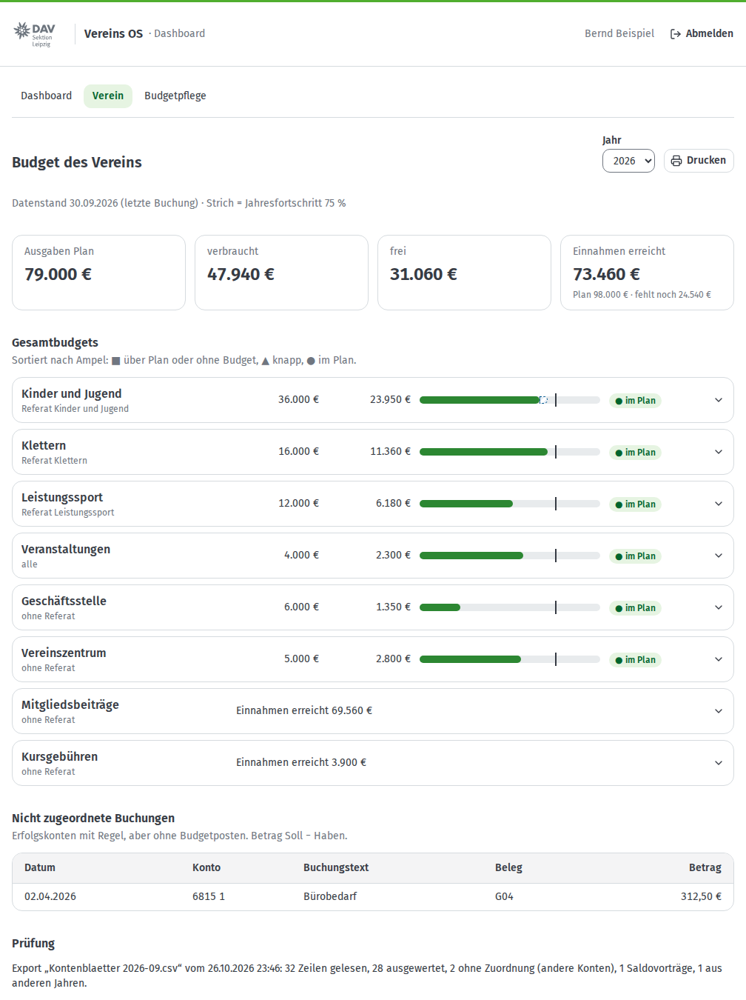

Wie du das Dashboard liest, steht im Abschnitt [Dashboard](02-referentinnen.md#dashboard-budget-meines-referats). Finanzplan, Zuordnung und DATEV-Import pflegt die Budgetpflege: [Anleitung für die Budgetpflege](05-budgetpflege.md).

---

## Ehrenamtsmanagement

### Aktive pflegen

Wie bei den Referent:innen ([Aktive finden](02-referentinnen.md#aktive-finden), [Person anlegen](02-referentinnen.md#eine-person-anlegen), [Lizenz verlängern](02-referentinnen.md#lizenz-verlängern), [Status ändern](02-referentinnen.md#ehrenamtsstatus-ändern)). Unterschiede für dich:

- Du siehst **alle** Aktiven, auch **ausgeschiedene** (Filter „Ehrenamtsstatus“).
- Beim Anlegen ist die erste Zuordnung freiwillig.
- Du siehst und pflegst auch Angaben mit der Lesestufe „nur Geschäftsstelle und Admin“, zum Beispiel **Bankverbindung** und **Bestätigung steuerfreie Einnahmen**. Finanzen braucht beides für die Auszahlung.

### Gremien

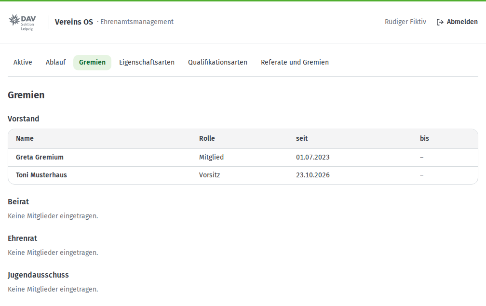

Unter **„Gremien“** siehst du, wer in Vorstand, Beirat, Ehrenrat und Jugendausschuss ist. Die Mitgliedschaft trägst du bei der Person als Eigenschaft ein.

### Referate und Gremien pflegen

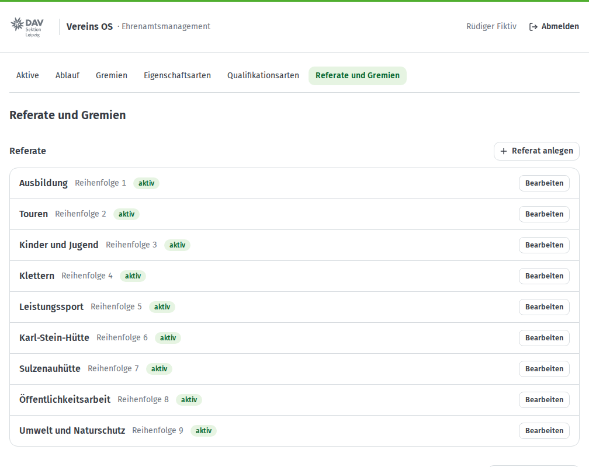

Unter **„Referate und Gremien“** legst du neue Referate oder Gremien an und änderst Name und Reihenfolge. Gelöscht wird nichts, damit die Historie erhalten bleibt.

### Eigenschaftsarten und Qualifikationsarten

- **Eigenschaftsarten** legen fest, was man zu einer Person eintragen kann, zum Beispiel „Funktion“ oder „Erste-Hilfe-Kurs am“. Neue Eigenschaftsarten kannst du selbst anlegen. Wie das geht, steht in der [Anleitung für den Admin](04-admin.md#eigenschaftsarten).
- **Qualifikationsarten** sind die Lizenzen und Ausbildungen des DAV, zum Beispiel „Trainer*in C Sportklettern“. Neue Ausbildungen trägst du hier ein.

---

## Gruppen

Hier verwaltest du die Gruppen im Kinder-, Jugend- und Erwachsenenbereich mit ihren Teilnehmer:innen. Das ersetzt die Excel-Teilnehmerlisten.

### Gruppen-Übersicht

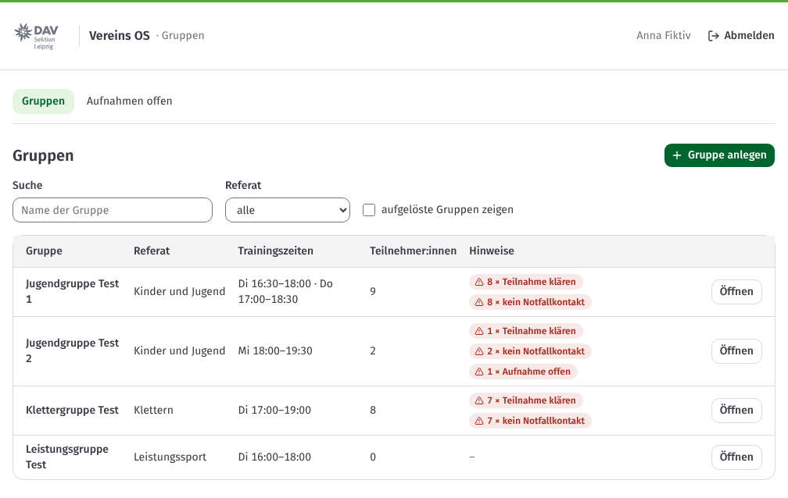

In der Spalte **„Hinweise“** siehst du, wo etwas fehlt, zum Beispiel „kein Notfallkontakt“ oder „Teilnahme klären“. Mit **„Gruppe anlegen“** legst du eine neue Gruppe an.

### Eine Gruppe ansehen

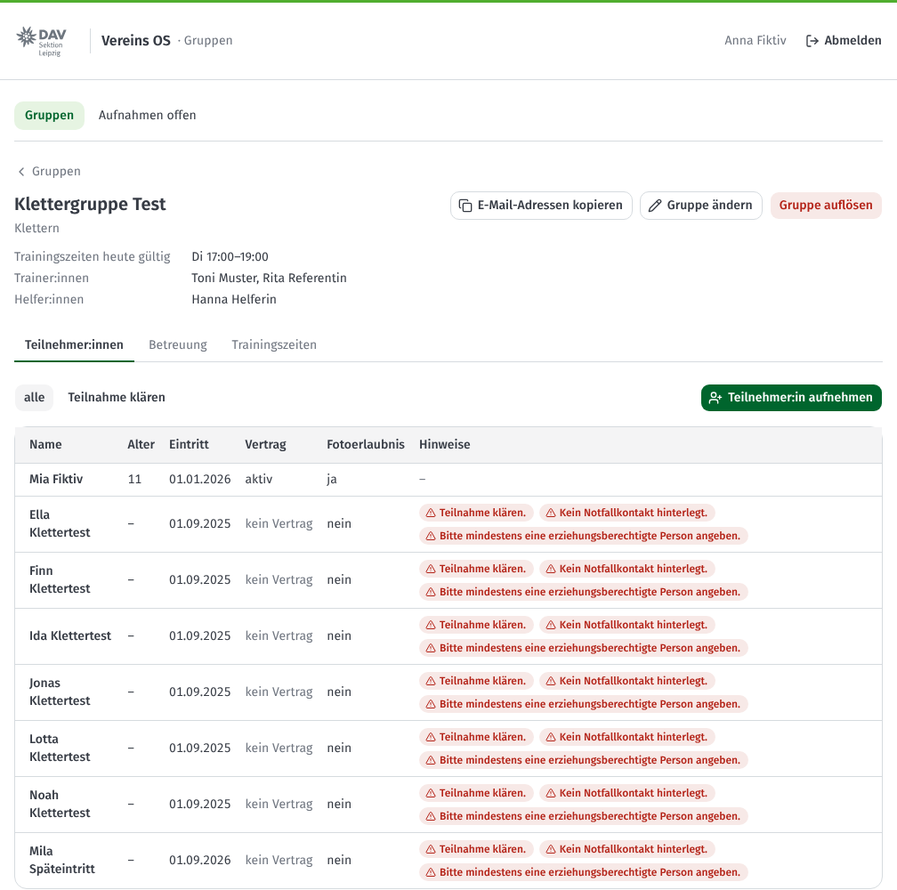

Eine Gruppe hat drei Reiter:

- **Teilnehmer:innen:** die Liste der Kinder mit Alter, Eintritt, Vertrag, Fotoerlaubnis und Hinweisen.
- **Betreuung:** Gruppenleitung, Trainer:innen und Helfer:innen. Mit **„Funktion hinzufügen“** trägst du jemanden ein, mit **„Beenden“** trägst du jemanden aus.
- **Trainingszeiten:** Wochentag und Uhrzeit. Die Anwesenheitserfassung nutzt sie für Trainings.

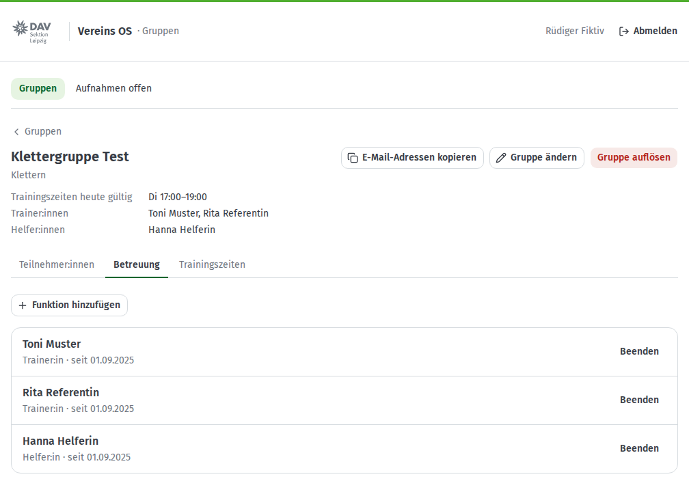

Oben findest du außerdem:

- **„E-Mail-Adressen kopieren“:** kopiert die Adressen der Gruppe, zum Beispiel für eine Rundmail.
- **„Gruppe ändern“** und **„Gruppe auflösen“**.

### Ein Kind aufnehmen

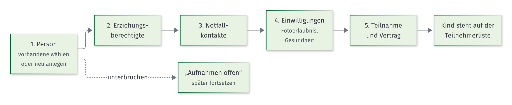

1. Öffne die Gruppe und klicke auf **„Teilnehmer:in aufnehmen“**.
2. **Person:** Suche, ob das Kind schon im Vereins OS ist (zum Beispiel aus einer anderen Gruppe). Wenn nicht, wähle **„Neue Person“**.
3. **Erziehungsberechtigte:** Eltern oder andere Erziehungsberechtigte eintragen oder auswählen.
4. **Notfallkontakte:** mindestens eine Person, die man im Notfall anruft.
5. **Einwilligungen:** Fotoerlaubnis und, wenn schriftlich erlaubt, Gesundheitsangaben.
6. **Teilnahme und Vertrag:** Eintrittsdatum, Beitrag und Bankdaten für den Beitrag.

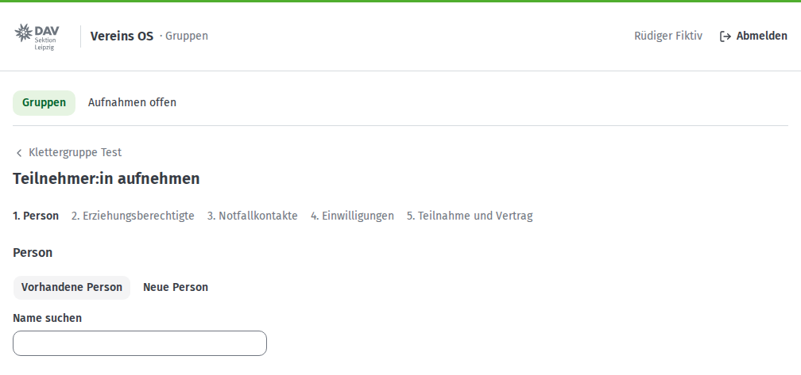

Du musst nicht alles auf einmal machen. Eine unterbrochene Aufnahme findest du unter **„Aufnahmen offen“**. Dort klickst du auf **„Aufnahme fortsetzen“**.

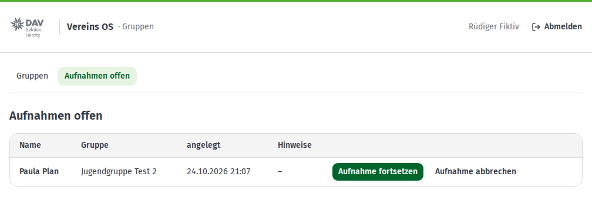

### Daten eines Kindes pflegen

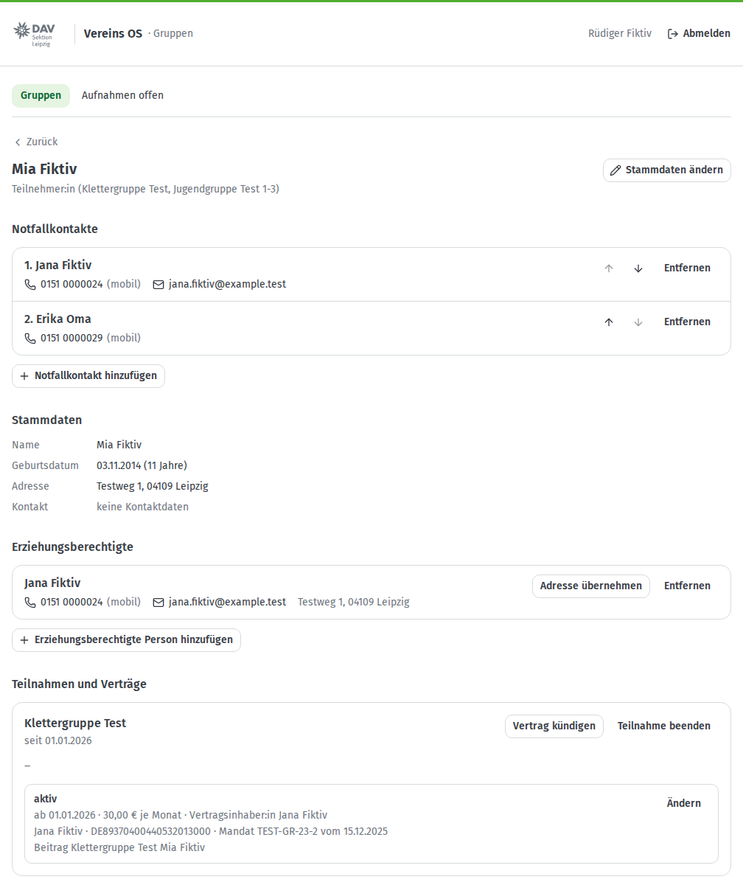

Klicke in der Teilnehmerliste auf einen Namen. Hier kannst du:

- **Notfallkontakte** ergänzen oder entfernen. Sie stehen ganz oben, damit man sie unterwegs schnell findet.
- **Stammdaten ändern**, zum Beispiel die Adresse.
- **Erziehungsberechtigte** ergänzen. Mit „Adresse übernehmen“ übernimmst du ihre Adresse für das Kind.
- **Vertrag kündigen** oder **Teilnahme beenden**, wenn ein Kind die Gruppe verlässt.
- **Fotoerlaubnis** und **Gesundheit** ändern.

Das Datum einer Änderung an Fotoerlaubnis oder Einwilligung darf nicht vor dem letzten Eintrag liegen. Für den gleichen Tag geht es.

> **Gut zu wissen:** Gesundheitsangaben nur eintragen, wenn eine schriftliche Einwilligung der Erziehungsberechtigten vorliegt. Nur das, was für Training und Fahrten nötig ist.

---

## Anwesenheitserfassung

Einsätze erfassen und korrigieren funktioniert wie bei den Referent:innen: [Anwesenheitserfassung](02-referentinnen.md#anwesenheitserfassung). Für dich zusätzlich:

- Du siehst die Einsätze **aller Referate**.
- Nur du kannst einen Einsatz **löschen** (Knopf „Löschen“ im Einsatz). Löschen nur bei Fehlern, zum Beispiel bei einem doppelt erfassten Einsatz. Fand ein Einsatz nicht statt, besser **„Absagen“**.
- **Vergütung:** Jeder Einsatz hat eine Vergütung, vorbelegt aus der Einsatzart. Ändere sie nur, wenn für diesen Einsatz eine andere Vergütung gilt.

### Kontrolle Kletterhalle

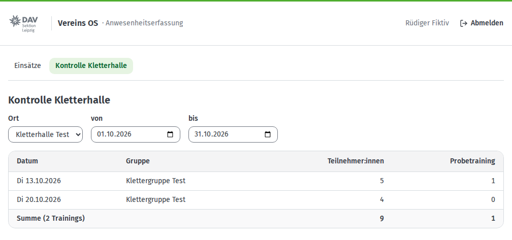

Wähle **Ort** und **Zeitraum** (von, bis). Du siehst je Training, wie viele Kinder und Probetrainings es gab, mit Summe.

---

## Finanzen

Zweimal im Jahr rechnest du die Vergütung der Trainer:innen und Helfer:innen nach der Vergütungsordnung ab. Grundlage ist die Anwesenheitserfassung.

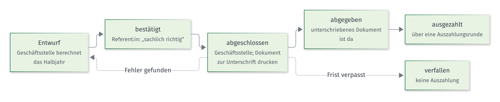

### 1. Halbjahr berechnen

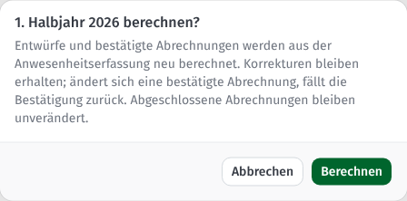

1. Öffne **„Finanzen“** und wähle oben das **Halbjahr**.
2. Klicke auf **„Berechnen“** und bestätige.

Das Vereins OS erstellt für jede Person eine Abrechnung im Zustand **Entwurf**. Du kannst jederzeit neu berechnen, zum Beispiel nach Korrekturen in der Anwesenheitserfassung. Abgeschlossene Abrechnungen bleiben dabei unverändert. Ändert sich eine bestätigte Abrechnung, muss die Referent:in sie neu bestätigen.

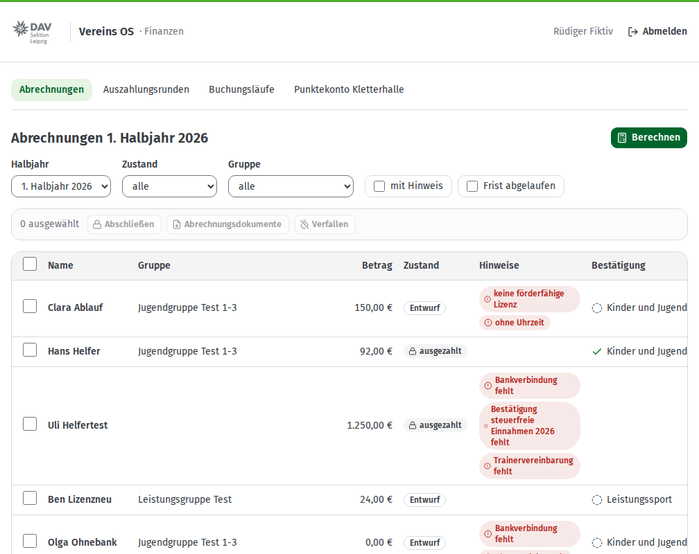

Filter helfen dir: **Zustand**, **Gruppe**, **mit Hinweis** und **Frist abgelaufen**.

### 2. Hinweise klären

Rote Hinweise zeigen, wo etwas fehlt, zum Beispiel **Bankverbindung fehlt**, **Bestätigung steuerfreie Einnahmen fehlt** oder **Höchstbetrag überschritten**. Fehlende Angaben trägst du im Ehrenamtsmanagement bei der Person nach und berechnest dann neu.

Eine einzelne Position kannst du in der Abrechnung mit **„Korrigieren“** anpassen. Korrekturen bleiben auch beim Neuberechnen erhalten.

### 3. Bestätigung abwarten

Die Referent:innen bestätigen ihre Abrechnungen als „sachlich richtig“. In der Spalte **„Bestätigung“** siehst du den Stand je Referat.

Ist keine Referent:in erreichbar und die Frist drängt, klicke in der Abrechnung auf **„In Vertretung bestätigen“**. Du musst einen Grund angeben. Diese Abrechnung schließt dann eine **zweite** Person der Geschäftsstelle ab.

### 4. Abschließen und Dokument drucken

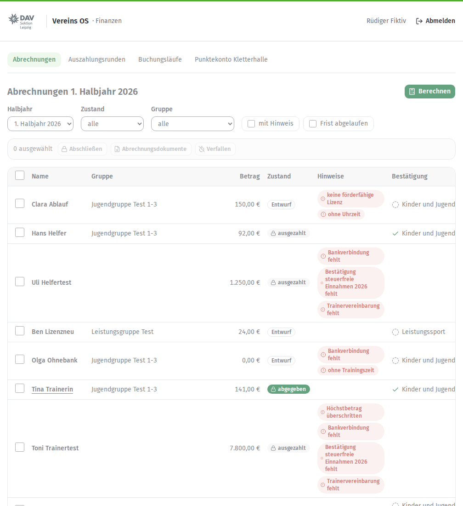

1. Öffne eine bestätigte Abrechnung und klicke auf **„Abschließen“**. Mehrere auf einmal: in der Liste ankreuzen und oben auf „Abschließen“ klicken.
2. Klicke auf **„Abrechnungsdokument“**. Das PDF druckst du aus. Die Person unterschreibt es.

Nach dem Abschluss sind die abgerechneten Anwesenheiten in der Anwesenheitserfassung gesperrt. Hast du einen Fehler gefunden? **„Abschluss zurücknehmen“** setzt die Abrechnung zurück auf Entwurf.

### 5. Abgabe erfassen

Kommt das unterschriebene Dokument zurück, klicke auf **„Abgabe erfassen“** und trage das Datum ein. Die Abgabefrist steht in der Abrechnung.

Kommt nichts bis zur Frist, klicke auf **„Verfallen“**. Verfallene Abrechnungen werden nicht ausgezahlt.

### 6. Auszahlen

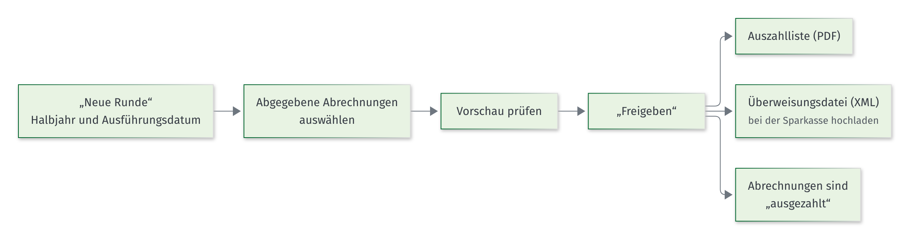

1. Klicke oben auf **„Auszahlungsrunden“** und dann auf **„Neue Runde“**.
2. Wähle das **Halbjahr** und das **Ausführungsdatum**.
3. Wähle die **abgegebenen Abrechnungen** aus, die du auszahlen willst.
4. Prüfe die **Vorschau der Auszahlzeilen**.
5. Klicke auf **„Freigeben“**.

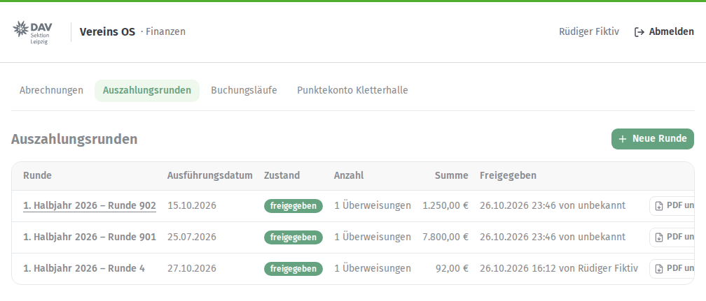

Du bekommst zwei Dateien:

- die **Auszahlliste (PDF)** für die Unterlagen,
- die **Überweisungsdatei (XML)**. Lade sie im Online-Banking der Sparkasse hoch.

Die Abrechnungen sind danach **„ausgezahlt“**. Die Dateien kannst du später in der Liste der Runden mit **„Dateien erneut abrufen“** noch einmal herunterladen.

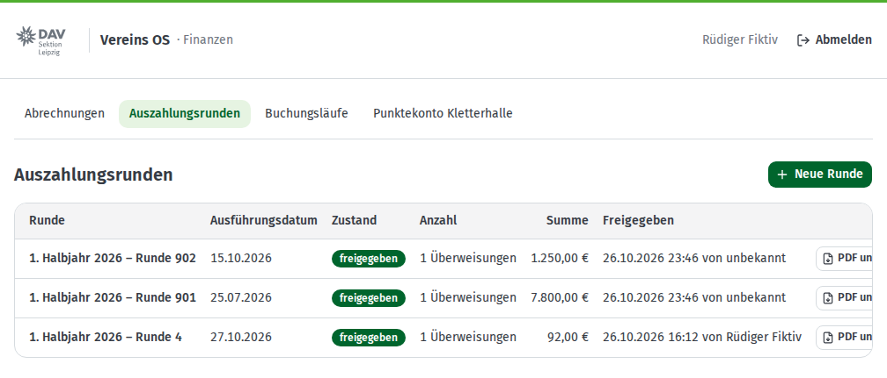

### Punktekonto Kletterhalle prüfen

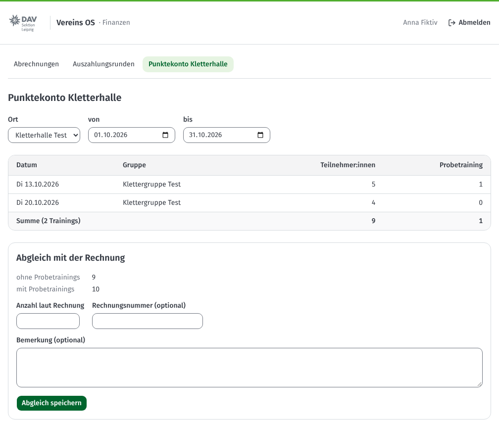

1. Klicke oben auf **„Punktekonto Kletterhalle“**.
2. Wähle **Ort** und **Zeitraum** der Rechnung.
3. Trage die **Anzahl laut Rechnung** ein, wenn du willst auch die Rechnungsnummer.
4. Das Vereins OS zeigt die Abweichung. Klicke auf **„Abgleich speichern“**.

---

## Planungshilfe Touren und Kurse

Die Planungshilfe funktioniert für dich wie für die Referent:innen: [Anleitung für Referent:innen](02-referentinnen.md#planungshilfe-touren-und-kurse). Du siehst die Planungen **aller Referate**. Zusätzlich gilt:

- **Bearbeiten nach der Freigabe:** Du darfst freigegebene Planungen weiter ändern. Änderungen an Termin, Leitung, Beitrag und Gesamtkosten stehen im **Verlauf**.
- **Nicht freigeben:** Freigeben dürfen nur Personen mit der Rechtevorlage „Freigabe Touren und Kurse“. Du kannst aber Rückfragen stellen.
- **In Yolawo angelegt:** Das darfst du setzen, wenn das Angebot in Yolawo steht.
- **Abschließen:** Ist eine Tour durchgeführt und abgerechnet, klickst du auf **„Abschließen“**. Danach kann niemand mehr etwas ändern.
- **Löschen:** Entwürfe und abgesagte Planungen ohne Einsatz kannst du löschen.
- **Lizenzen:** Bekommt jemand den Helfersatz, obwohl er oder sie eine Lizenz hat, trage die Lizenz im Ehrenamtsmanagement ein. Die Planung rechnet danach beim nächsten Speichern den Trainersatz.
- **Kostenauswertung:** Unter **„Auswertung“** lädst du die Tabelle mit **„CSV herunterladen“** herunter, zum Beispiel für Excel. Kontakt- und Notfalldaten stehen nicht darin.

