# Anleitung für den Admin

Für den Admin mit der Rechtevorlage „Admin“. Der Admin richtet Personen, Zugänge und Rechte ein und pflegt die Stammdaten.

[Zurück zur Übersicht](README.md) · Zuerst lesen: [Erste Schritte](01-erste-schritte.md)

## Was du siehst

| Modul | Deine Rechte |
|---|---|
| Administration | verwalten: alles |
| Ehrenamtsmanagement | verwalten: wie die Geschäftsstelle, dazu vertrauliche Angaben |
| Gruppen, Anwesenheitserfassung | lesen (zum Beispiel für einen Notfall auf einer Ausfahrt) |

Die Seiten der Administration findest du oben in der Leiste: Personen, Rechtevorlagen, Eigenschaftsarten, Qualifikationsarten, Sätze, Abrechnungsarten, Auszahlung, Protokoll.

---

## Personen und Zugänge

### Die Personenliste

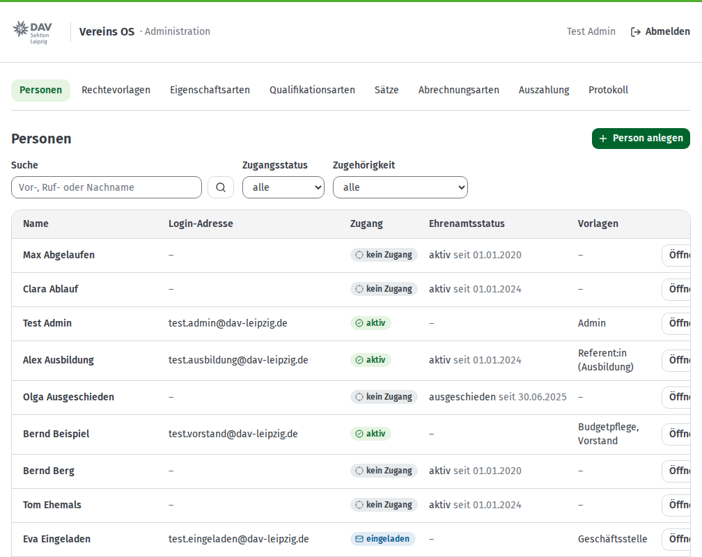

Hier siehst du **alle Personen** aus allen Modulen. Mit **Suche**, **Zugangsstatus** und **Zugehörigkeit** grenzt du die Liste ein.

Der **Zugang** hat einen von vier Zuständen:

| Zustand | Bedeutung |
|---|---|
| kein Zugang | Die Person kann sich nicht anmelden. Das ist der Normalfall. |
| eingeladen | Die Einladung ist verschickt, das Passwort noch nicht gesetzt. |
| aktiv | Die Person kann sich anmelden. |
| gesperrt | Die Person kann sich nicht mehr anmelden. |

### Einer Person einen Zugang geben

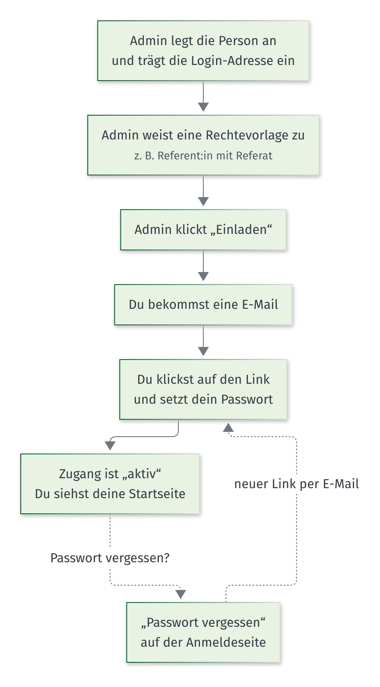

**Schritt 1: Person anlegen**

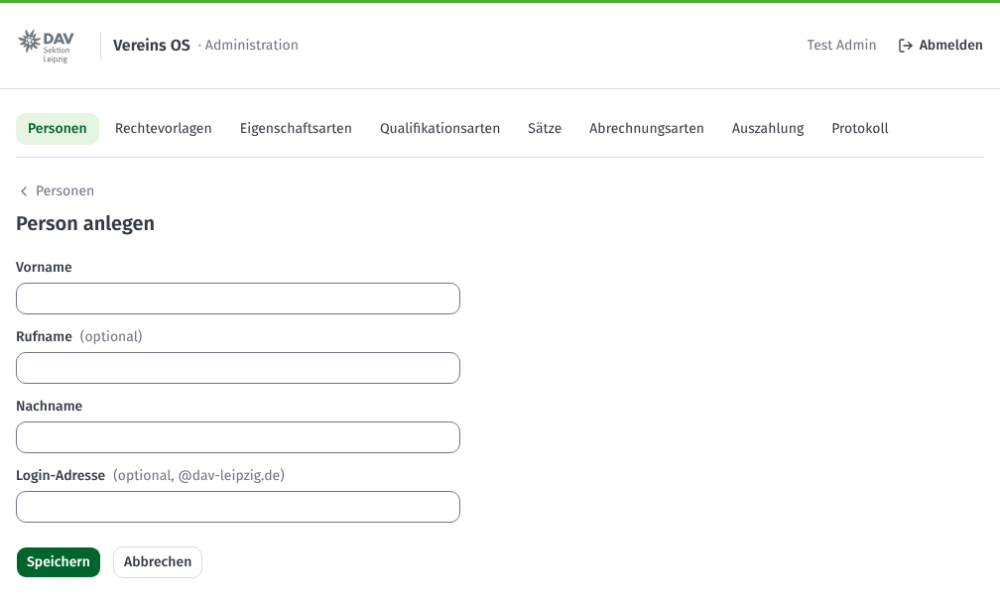

1. Klicke in **„Personen“** auf **„Person anlegen“**.
2. Trage **Vorname**, **Nachname** und die **Login-Adresse** (@dav-leipzig.de) ein.
3. Klicke auf **„Speichern“**.

Gibt es die Person schon, zum Beispiel aus dem Ehrenamtsmanagement, lege sie nicht neu an. Öffne sie in der Liste und klicke bei „Zugang“ auf **„Login-Adresse festlegen“**.

**Schritt 2: Rechtevorlage zuweisen**

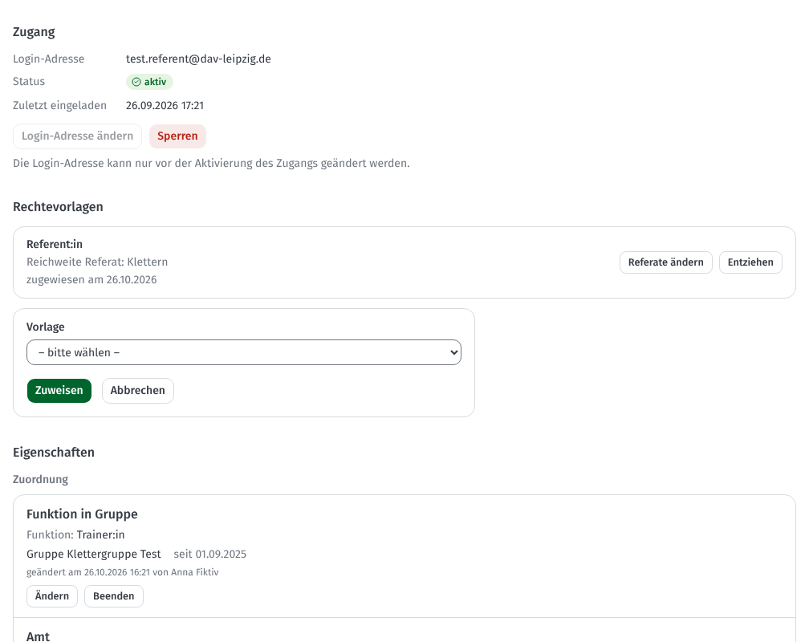

1. Öffne die Person.
2. Klicke unter **„Rechtevorlagen“** auf **„Vorlage hinzufügen“**.
3. Wähle die Vorlage, zum Beispiel „Referent:in“.
4. Bei Vorlagen mit Reichweite „Referat“ wählst du die **Referate**.
5. Klicke auf **„Zuweisen“**.

**Schritt 3: Einladen**

Klicke bei „Zugang“ auf **„Einladen“**. Die Person bekommt eine E-Mail. Sobald sie ihr Passwort gesetzt hat, steht der Zugang auf **aktiv**.

### Einen Zugang verwalten

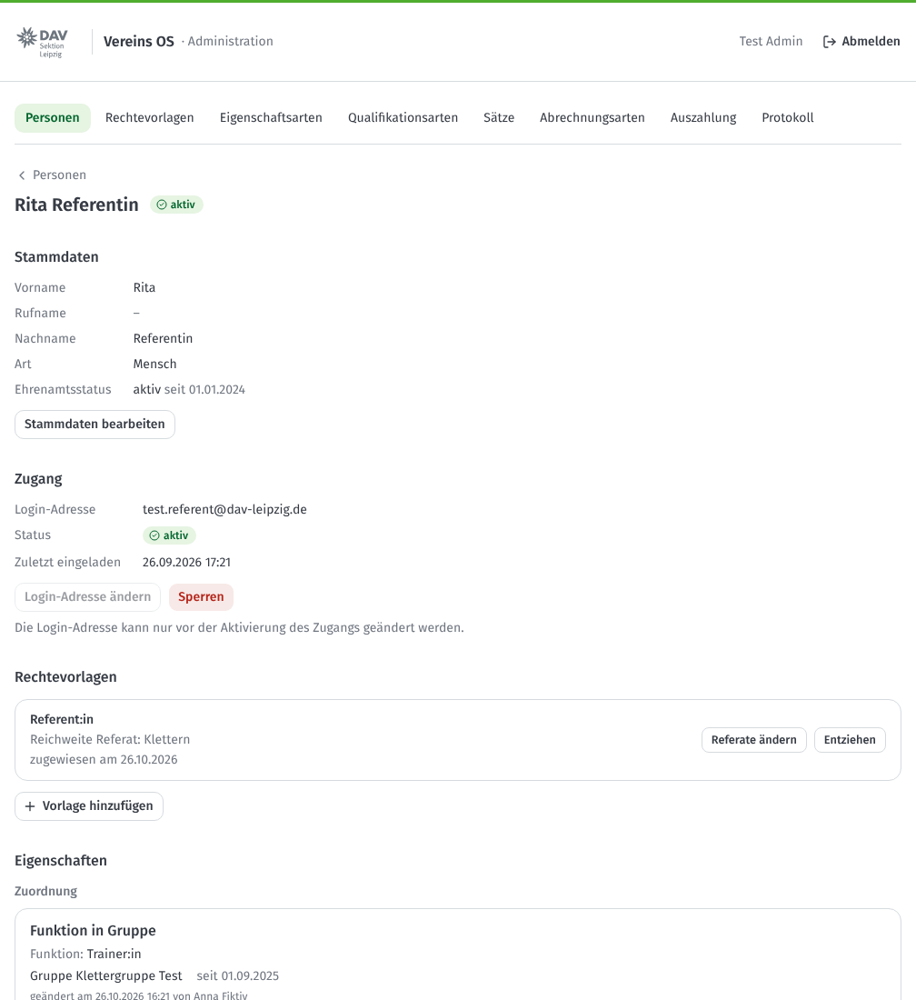

| Was du willst | So geht es |
|---|---|
| Einladung noch einmal schicken | **„Erneut einladen“**. Der alte Link wird ungültig. |
| Login-Adresse korrigieren | **„Login-Adresse ändern“**. Geht nur, solange der Zugang noch nicht aktiv ist. |
| Person darf sich nicht mehr anmelden | **„Sperren“**. Mit **„Entsperren“** machst du das rückgängig. |
| Referate einer Vorlage ändern | bei der Vorlage **„Referate ändern“** |
| Rechte wegnehmen | bei der Vorlage **„Entziehen“** |
| Name korrigieren | **„Stammdaten bearbeiten“** |

> **Gut zu wissen:** Ein Amt bringt keine Rechte mit. Wird jemand Referent:in, musst du die Vorlage selbst zuweisen. Hört jemand auf, entziehe die Vorlage oder sperre den Zugang.

> **Schutz vor Aussperren:** Deinen eigenen Zugang kannst du nicht sperren. Den Zugang des Notfall-Admins kannst du nicht sperren und ihm die Admin-Rechte nicht entziehen. Mindestens ein aktiver Zugang muss die Administration verwalten können: Den letzten solchen Zugang kannst du nicht sperren, ihm die Vorlage nicht entziehen und in seiner Vorlage die Stufe für die Administration nicht herabsetzen.

### Eigenschaften einer Person

Unten auf der Detailseite pflegst du die **Eigenschaften** der Person, zum Beispiel Kontaktdaten oder Funktionen. Das geht genauso wie im [Ehrenamtsmanagement](02-referentinnen.md#eine-person-ansehen). Als Admin siehst du auch **vertrauliche** Eigenschaften, zum Beispiel ein Hauptamt.

### Notfall-Admin

Es gibt einen zweiten Admin-Zugang über das Postfach der Geschäftsstelle. Er ist nur dafür da, dass niemand ausgesperrt wird. Meldet sich der Notfall-Admin an, siehst du oben in der Personenliste einen gelben Hinweis. Prüfe, ob die Anmeldung in Ordnung war, und klicke auf **„Zur Kenntnis genommen“**.

---

## Rechtevorlagen

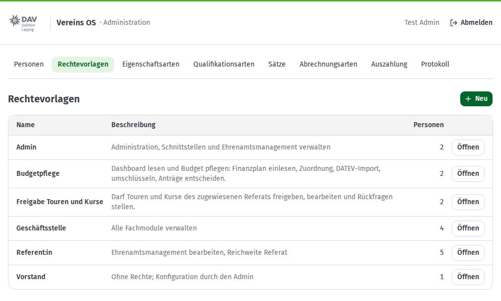

Eine Rechtevorlage legt fest, was jemand in jedem Modul darf. Eine Person kann mehrere Vorlagen haben. Je Modul gilt dann die höchste Stufe.

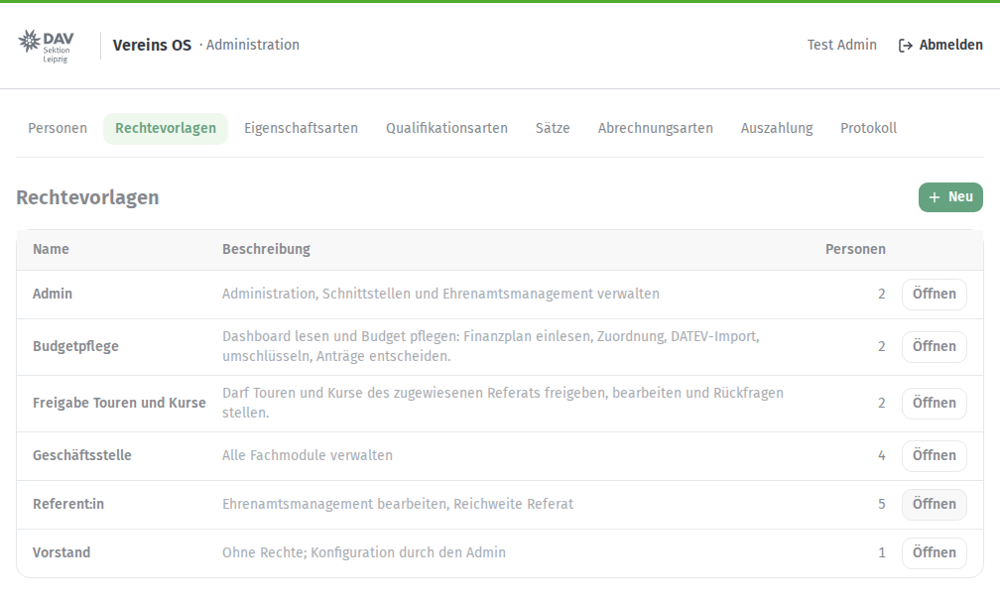

1. Klicke auf eine Vorlage oder auf **„Neu“**.
2. Wähle je Modul eine Stufe: **kein Zugriff**, **lesen**, **bearbeiten** oder **verwalten**.
3. **Reichweite:** „alle“ oder „Referat“. Die Referate wählst du später bei der Zuweisung an eine Person.
4. **darf freigeben:** In Finanzen heißt das, Abrechnungen als „sachlich richtig“ bestätigen. Beim Dashboard steht an dieser Stelle **„Budget pflegen“**: Finanzplan, Zuordnung und DATEV-Import pflegen und Anträge entscheiden. Das geht nur mit Reichweite „alle“.
5. Klicke auf **„Speichern“**.

Änderungen gelten sofort für alle Personen mit dieser Vorlage.

| Vorlage | Für wen |
|---|---|
| Admin | Product Owner |
| Geschäftsstelle | Mitarbeiter:innen der Geschäftsstelle |
| Referent:in | Referent:innen und Hüttenwart:innen, mit ihren Referaten |
| Vorstand | Dashboard lesen (alle Referate) |
| Budgetpflege | 1. Vorsitzende:r und Schatzmeister:in: Dashboard lesen und Budget pflegen |

Die Rechtevorlage „Referent:in“ hat im Dashboard „lesen“ mit Reichweite „Referat“: Referent:innen sehen das Budget ihrer Referate mit Einzelbuchungen und die Summen aller anderen.

---

## Eigenschaftsarten

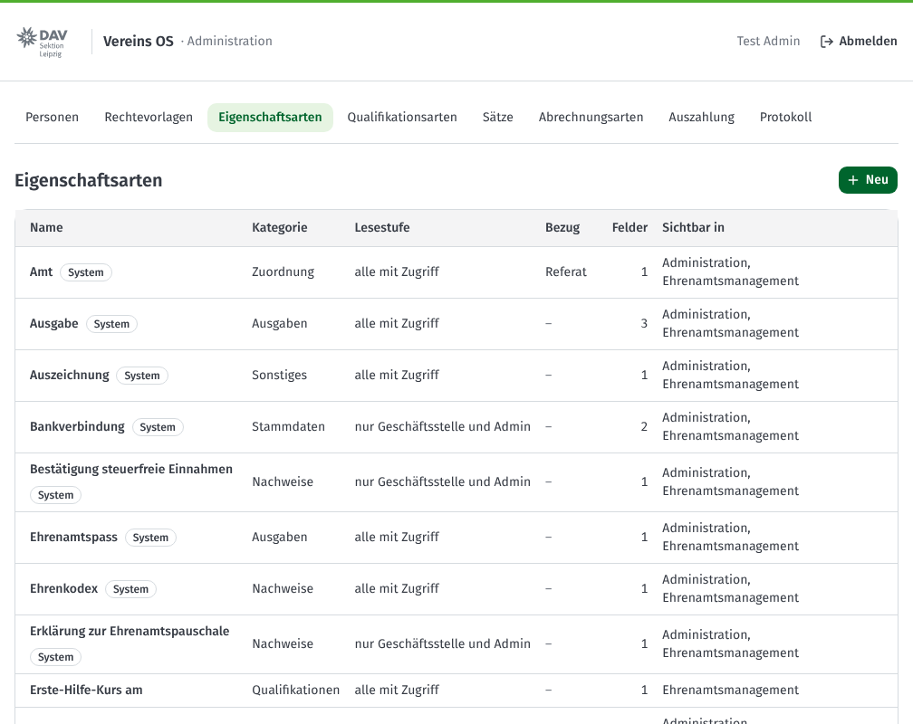

Eine Eigenschaftsart legt fest, **was** man zu einer Person eintragen kann. Beispiele: Funktion, Lizenz, Bankverbindung, Erste-Hilfe-Kurs.

Mit **„Neu“** legst du eine Eigenschaftsart an:

- **Zweck:** wofür die Angabe gebraucht wird (Pflicht).
- **Kategorie:** Bereich auf der Detailseite, zum Beispiel „Nachweise“.
- **Lesestufe:** Wer darf die Angabe sehen?
  - *alle mit Zugriff:* alle, die die Person sehen dürfen
  - *nur Geschäftsstelle und Admin:* zum Beispiel Bankverbindung
  - *vertraulich:* nur der Admin
- **Bezug:** optional ein Referat, Gremium oder eine Gruppe.
- **Felder:** eine oder mehrere Angaben mit Datentyp, zum Beispiel Text, Datum, Ja/Nein, Auswahlliste oder Qualifikationsart.
- **Sichtbar in:** in welchen Modulen die Angabe angezeigt wird.

Eigenschaftsarten mit dem Zeichen **System** braucht das Vereins OS selbst. Ändere sie vorsichtig.

## Qualifikationsarten

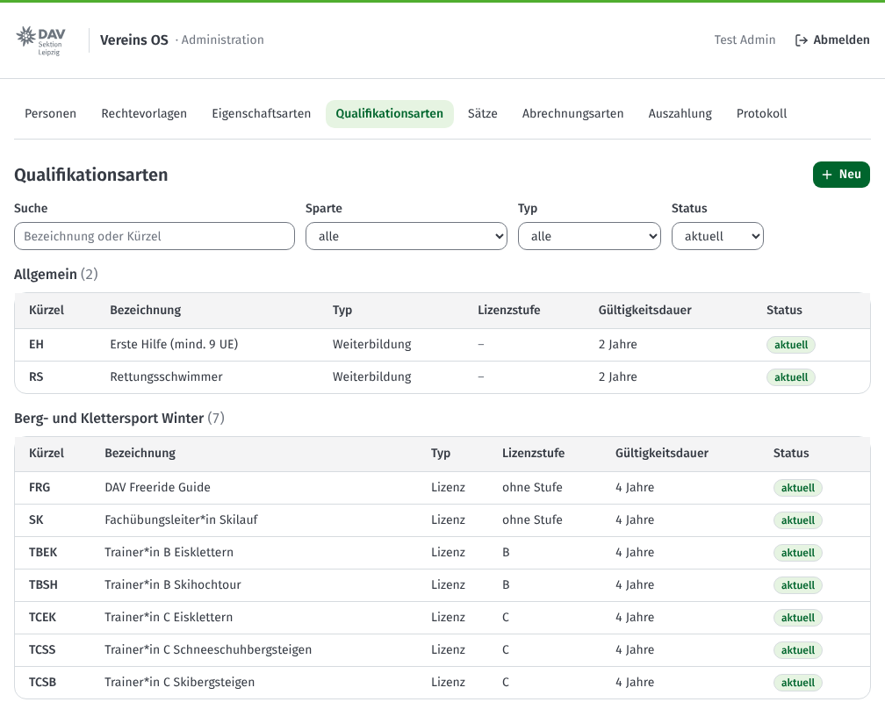

Hier stehen die Lizenzen und Ausbildungen des DAV mit Kürzel, Lizenzstufe und Gültigkeitsdauer. Die Spalte **„Personen“** zeigt, wie viele Personen die Qualifikation gerade haben. **„DOSB-lizenzfähig“** ist wichtig für Finanzen: Nur mit einer förderfähigen Lizenz gibt es den Trainer:innen-Satz. Gelöscht wird nichts.

---

## Einstellungen für Finanzen

### Sätze

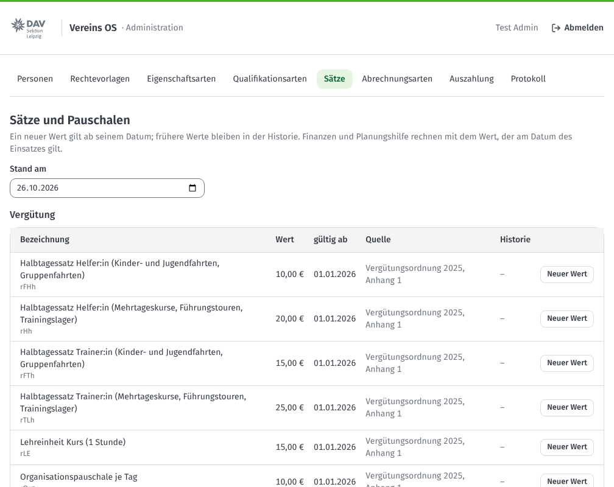

Hier stehen die Beträge aus der Vergütungsordnung, zum Beispiel der Tagessatz für Trainer:innen. Ändert sich ein Betrag, klicke auf **„Neuer Wert“** und trage den Betrag und das Datum **„gültig ab“** ein. Der alte Wert bleibt in der Historie. Finanzen rechnet immer mit dem Wert, der am Tag des Einsatzes galt.

### Abrechnungsarten

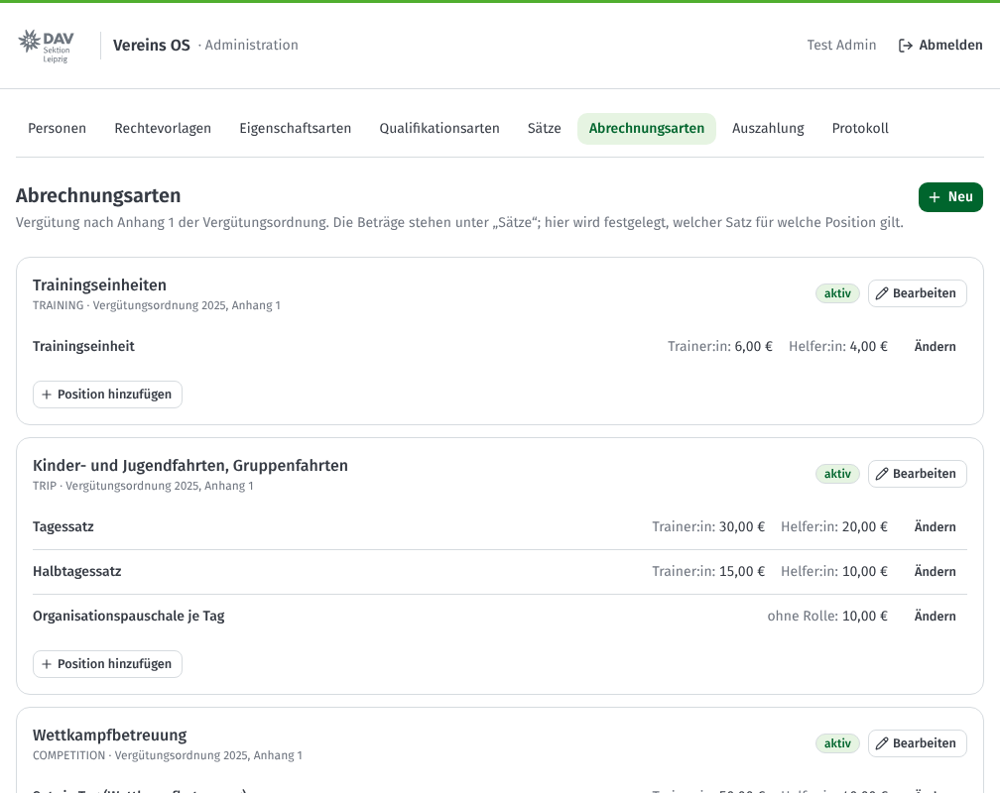

Eine Abrechnungsart legt fest, **welcher Satz** für welche Position gilt, zum Beispiel „Trainingseinheiten: Trainer:in 6 €, Helfer:in 4 €“. Jeder Einsatzart ist eine Abrechnungsart vorbelegt.

### Auszahlung

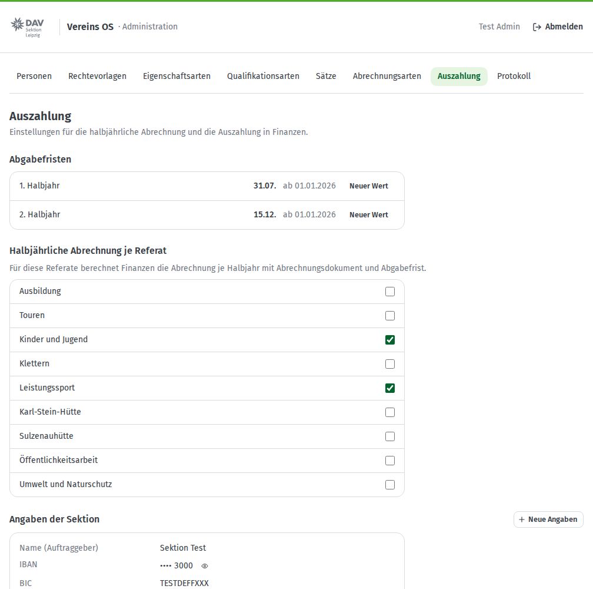

- **Abgabefristen** je Halbjahr.
- **Halbjährliche Abrechnung je Referat:** Für diese Referate rechnet Finanzen je Halbjahr ab.
- **Angaben der Sektion:** Name, IBAN und BIC für die Überweisungsdatei.

---

## Protokoll

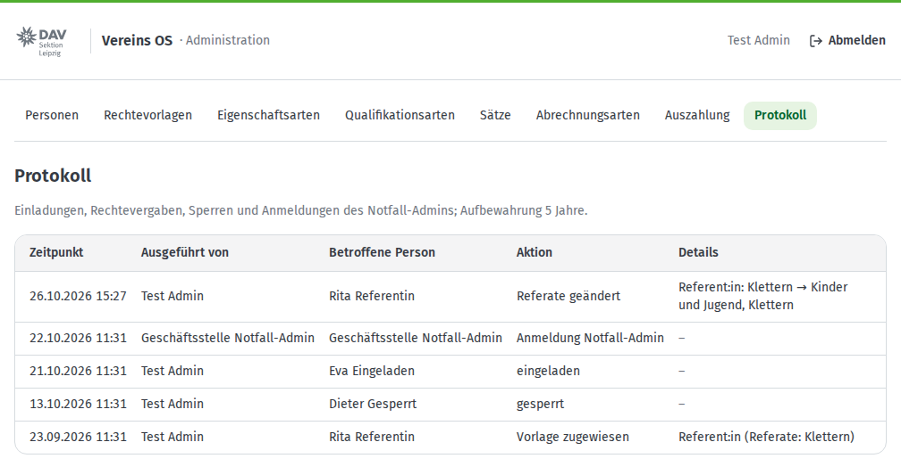

Das Protokoll zeigt, wer wann jemanden eingeladen, gesperrt oder Rechte vergeben hat. Es wird 5 Jahre aufbewahrt.
