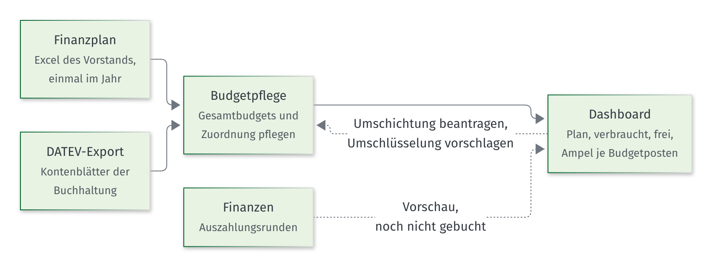
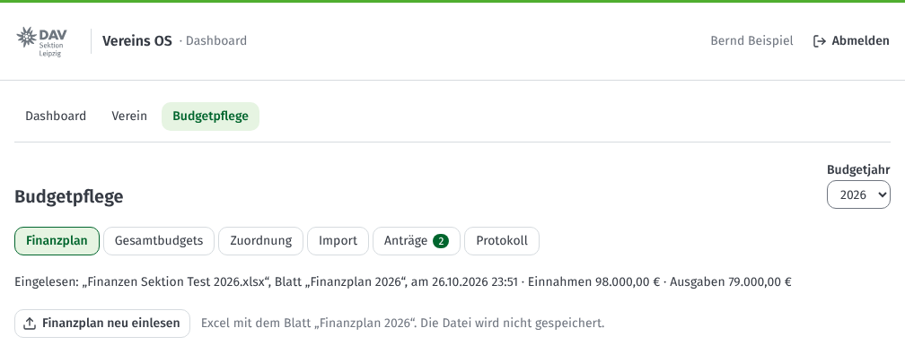
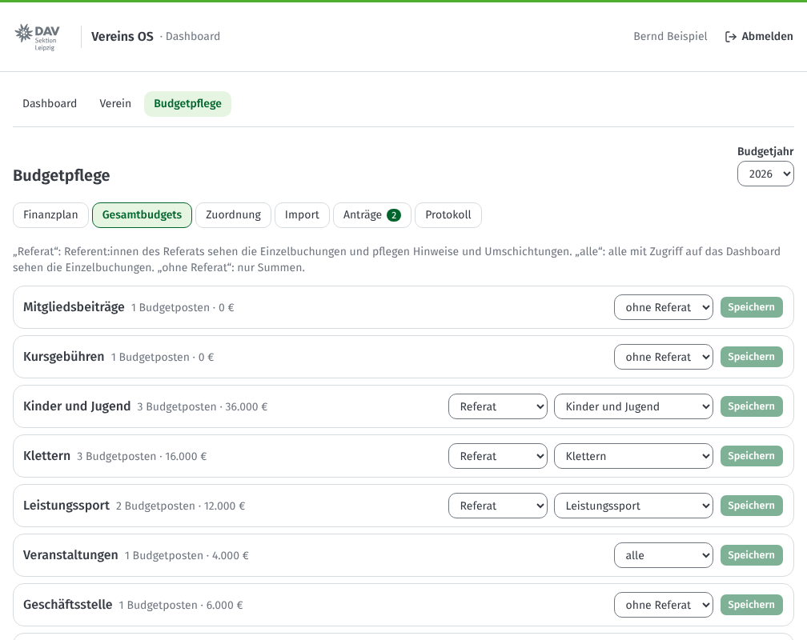
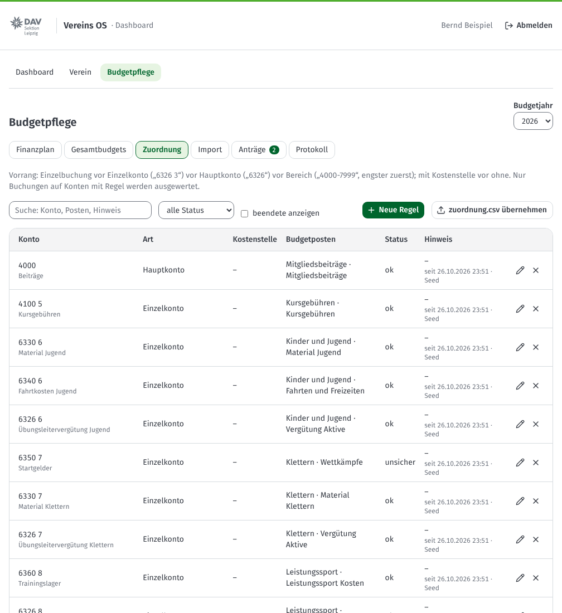
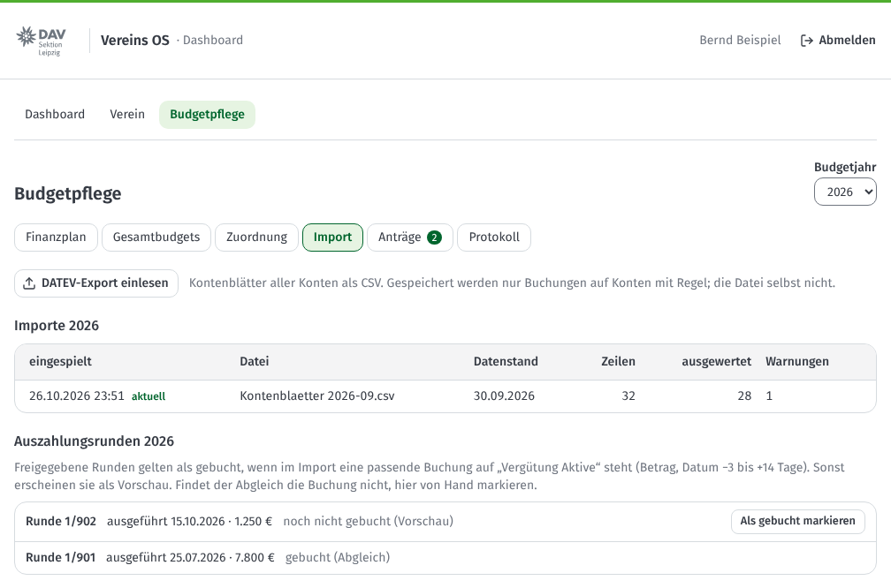
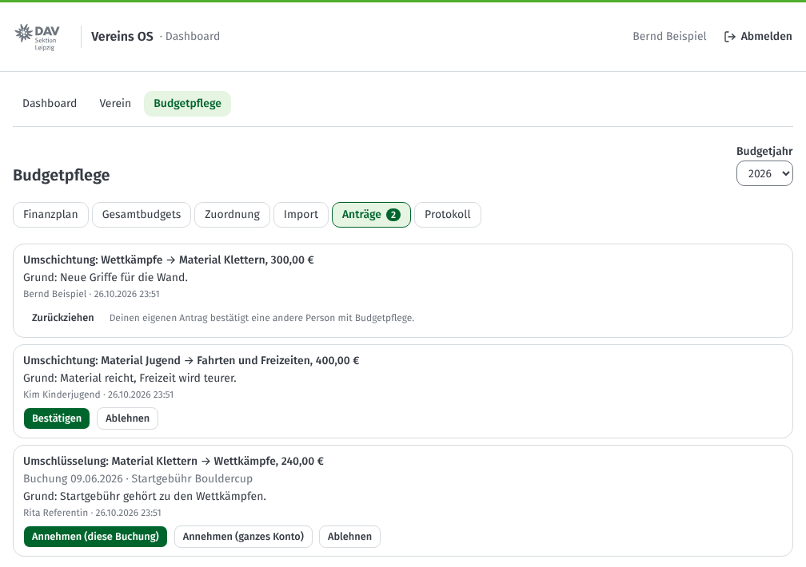

# Anleitung für die Budgetpflege

Für alle mit der Rechtevorlage „Budgetpflege“, zum Beispiel 1. Vorsitzende:r und Schatzmeister:in.

[Zurück zur Übersicht](README.md) · Zuerst lesen: [Erste Schritte](01-erste-schritte.md) und den Abschnitt [Dashboard](02-referentinnen.md#dashboard-budget-meines-referats)

*Die Bilder zeigen erfundene Testdaten.*

## Was du tust

Du sorgst dafür, dass im Dashboard die richtigen Zahlen stehen. Das Geld kommt aus **einer Quelle**: dem Finanzplan des Vorstands und dem DATEV-Export der Buchhaltung.

Du findest alles unter **„Dashboard“ → „Budgetpflege“**. Oben wählst du das **Budgetjahr**. Die Arbeit ist in Reiter geteilt:

| Reiter | Was du dort tust |
|---|---|
| Finanzplan | Excel einlesen, neues Jahr vorbereiten |
| Gesamtbudgets | Budgetposten gruppieren, Sichtbarkeit und Referat festlegen |
| Zuordnung | Regeln: welches Konto zählt zu welchem Budgetposten |
| Import | DATEV-Export einspielen, Auszahlungsrunden prüfen |
| Anträge | Umschichtungen bestätigen, Vorschläge zum Umschlüsseln annehmen |
| Protokoll | sehen, wer wann was geändert hat |

---

## Finanzplan einlesen

1. Wähle oben das **Budgetjahr**.
2. Klicke auf **„Finanzplan einlesen“** und wähle die Excel-Datei. Sie braucht ein Blatt **„Finanzplan JJJJ“** mit den Spalten „Einnahmen“ und „Ausgaben“ und je einer Spalte „Plan JJJJ“.
3. Du siehst eine **Vorschau**: neue, geänderte und entfallene Budgetposten und die Summen.
4. Stimmt alles, klicke auf **„Übernehmen“**.

Die Summe der Budgetposten muss zur Summenzeile der Excel passen. Sonst kommt eine Meldung und nichts wird übernommen. Die Datei selbst wird nicht gespeichert.

Kommt ein Name doppelt vor (zum Beispiel „Vergütung Aktive“), gehört der Posten zum Gesamtbudget des Postens darüber.

### Neues Jahr

Für ein neues Jahr liest du zuerst den Finanzplan des neuen Jahres ein. Danach klickst du unter **„Neues Jahr: aus dem Vorjahr übernehmen“** auf **„Vorschau“** und dann auf **„Übernehmen“**. So bekommst du die Sichtbarkeit der Gesamtbudgets und die Zuordnungsregeln des Vorjahres. Umschlüsselungen einzelner Buchungen gelten nur in ihrem Jahr.

## Gesamtbudgets

Ein **Gesamtbudget** fasst Budgetposten zusammen, zum Beispiel „Kinder und Jugend“. Für jedes Gesamtbudget legst du fest, wer was sieht:

- **Referat:** Die Referent:innen dieses Referats sehen die Einzelbuchungen. Sie können Hinweise eintragen und Umschichtungen beantragen.
- **alle:** Alle mit Zugriff auf das Dashboard sehen die Einzelbuchungen (zum Beispiel Veranstaltungen).
- **ohne Referat:** Alle sehen nur die Summen.

Die Summen aller Gesamtbudgets sehen alle mit Zugriff auf das Dashboard.

Ein Budgetposten gehört zum falschen Gesamtbudget? Klicke auf den Namen des Gesamtbudgets, trage beim Posten das richtige Gesamtbudget ein und klicke auf **„Verschieben“**.

## Zuordnung

Eine **Regel** sagt: Buchungen auf diesem Konto zählen zu diesem Budgetposten. Nur Buchungen auf Konten mit Regel werden ausgewertet. So zählt keine Buchung doppelt.

Du kannst ein Konto auf drei Arten angeben:

- **Einzelkonto:** „6326 3“
- **Hauptkonto:** „6326“ (alle Unterkonten)
- **Bereich:** „4000-7999“

Passen mehrere Regeln, gilt die genaueste: erst eine einzelne Buchung, dann das Einzelkonto, dann das Hauptkonto, dann der engste Bereich. Eine Regel mit Kostenstelle geht vor einer ohne.

- **Neue Regel:** Klicke auf **„Neue Regel“**, trage das Konto ein und wähle den Budgetposten. Ohne Budgetposten erscheinen die Buchungen als **„nicht zugeordnet“**.
- **Status:** „unsicher“ oder „offen“ markiert Regeln, die du noch klären willst. Der Budgetposten bekommt dann ein „?“.
- **Ändern** (Stift) und **Beenden** (Kreuz): Die alte Regel bleibt im Verlauf. Mit **„beendete anzeigen“** siehst du ihn.
- **zuordnung.csv übernehmen:** Die Datei aus dem früheren Finanzdashboard ersetzt alle Regeln des Jahres. Bei Fehlern wird nichts übernommen; du siehst die Zeilen mit Fehlern.

## DATEV-Export einspielen

1. Hol dir bei der Buchhaltung die **Kontenblätter aller Konten** als CSV-Datei.
2. Klicke auf **„DATEV-Export einlesen“** und wähle die Datei.
3. Prüfe die **Vorschau**: Wie viele Zeilen wurden gelesen und ausgewertet? Gibt es Warnungen?
4. Klicke auf **„Übernehmen“**. Der neue Export ersetzt den alten.

Warnungen in der Vorschau:

- **Export unvollständig:** Bei einem Konto passen die Einzelbuchungen nicht zur Kontenübersicht. Frag bei der Buchhaltung nach.
- **Umgeschlüsselte Buchung nicht mehr im Export:** Eine Buchung, die du umgeschlüsselt hast, fehlt. Prüfe sie unter „Verein“ → „Prüfung“.

Saldovorträge („EB-Wert“) und Buchungen aus anderen Jahren zählen nicht. Gespeichert werden nur Buchungen auf Konten mit Regel. Ist der letzte Export älter als 6 Wochen, erinnert dich „Zu tun“ daran.

### Auszahlungsrunden

Ausgezahlte Vergütung, die noch nicht gebucht ist, zeigt das Dashboard als **Vorschau** beim Budgetposten „Vergütung Aktive“. Sobald im Export eine passende Buchung steht (gleicher Betrag, Datum bis 3 Tage vor oder 14 Tage nach der Ausführung), verschwindet die Vorschau von selbst. Findet das Vereins OS die Buchung nicht, klicke bei der Runde auf **„Als gebucht markieren“**.

## Anträge entscheiden

- **Umschichtung:** Ein Referat möchte Geld zwischen zwei Posten seines Gesamtbudgets verschieben. Die Summe bleibt gleich. Klicke auf **„Bestätigen“** oder **„Ablehnen“** (mit Grund). Deinen eigenen Antrag bestätigt eine andere Person mit Budgetpflege.
- **Umschlüsselung:** Ein Referat meint, eine Buchung gehört zu einem anderen Budgetposten. Mit **„Annehmen (diese Buchung)“** gilt das nur für diese Buchung, mit **„Annehmen (ganzes Konto)“** für alle Buchungen auf dem Konto.

Du kannst auch selbst umschichten und umschlüsseln: in einem Budgetposten mit **„Umschichten“** oder bei einer Buchung mit **„Umschlüsseln“**. Eine Umschlüsselung nimmst du dort mit **„Zurücknehmen“** wieder zurück.

## Protokoll

Im Reiter **„Protokoll“** steht jede Änderung mit Datum: Finanzplan, Regeln, Importe, Anträge, Hinweise. Buchungstexte stehen dort nicht.

## Wie lange bleiben Buchungen gespeichert?

Einzelbuchungen bleiben für das laufende Jahr und das Vorjahr. Danach löscht das Vereins OS sie automatisch. Der Finanzplan und die Summen je Monat bleiben für den Vergleich mit dem Vorjahr.
