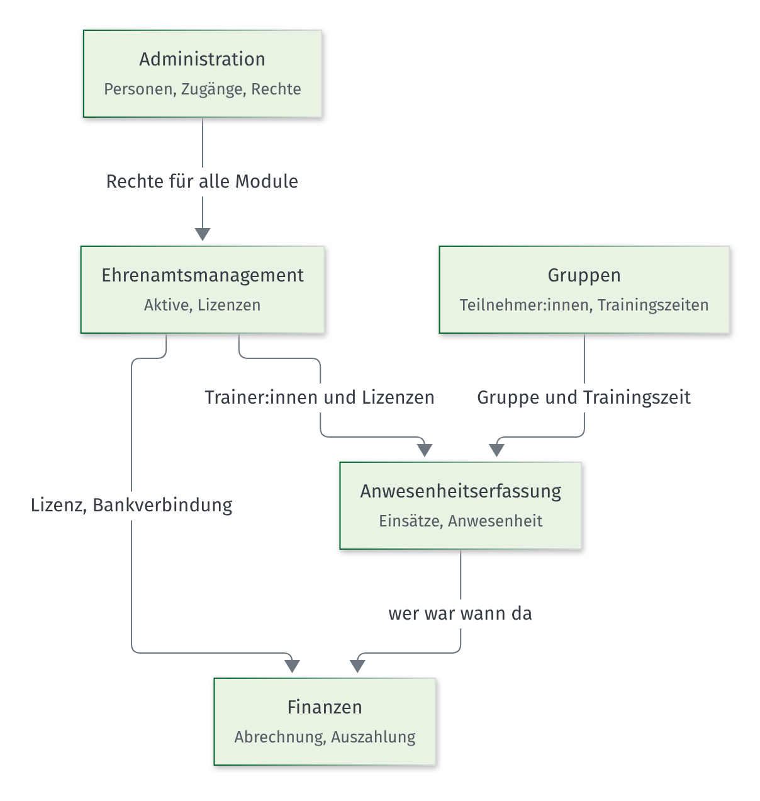

# Anleitung Vereins OS

Stand: 27.10.2026 · Version 3.0
Änderungen v3.0: neues Modul Planungshilfe Touren und Kurse (in Vorbereitung): Abschnitte für Referent:innen und Geschäftsstelle (Planung anlegen, Schritte 1–7, einreichen, freigeben, Yolawo, Ausgaben, PDF, Kostenauswertung); Bilder folgen vor der Freischaltung.
Änderungen v2.0: neues Modul Dashboard (Bereich Budget, in Vorbereitung) mit neuem Teil „Anleitung für die Budgetpflege“; Abschnitte Dashboard für Referent:innen und Geschäftsstelle, Startseite mit Dashboard, Kennzeichen „Budget pflegen“ in der Rechtevorlage, neue Wörter in der Wörterliste.
Änderungen v1.1: Gruppen, Anwesenheitserfassung und Finanzen sind freigeschaltet (Hinweise „in Vorbereitung“ entfernt, Startseite mit Kachel Finanzen); Abschnitt „Anleitung aktualisieren“ um das Nachziehen im Nachgang ergänzt.
Änderungen v1.0: erste Fassung mit Erste Schritte, Anleitungen für Referent:innen, Geschäftsstelle und Admin; Module Administration, Ehrenamtsmanagement, Gruppen, Anwesenheitserfassung, Finanzen.

Das Vereins OS ist das Online-Werkzeug der DAV Sektion Leipzig. Hier pflegen wir Aktive, Gruppen, Einsätze und Abrechnungen an einem Ort.

Diese Anleitung ist in einfacher Sprache geschrieben. Die Bilder zeigen nur **erfundene Testdaten**.

## Welche Anleitung ist für mich?

| Ich bin … | Lies diese Teile |
|---|---|
| **neu im Vereins OS** (alle) | [Erste Schritte](01-erste-schritte.md) |
| **Referent:in oder Hüttenwart:in** | [Erste Schritte](01-erste-schritte.md) und [Anleitung für Referent:innen](02-referentinnen.md) |
| **Mitarbeiter:in der Geschäftsstelle** | [Erste Schritte](01-erste-schritte.md) und [Anleitung für die Geschäftsstelle](03-geschaeftsstelle.md) |
| **Admin** | alle Teile, vor allem die [Anleitung für den Admin](04-admin.md) |
| **Vorstand** | [Erste Schritte](01-erste-schritte.md) und den Abschnitt [Dashboard](02-referentinnen.md#dashboard-budget-meines-referats) |
| **Budgetpflege** (1. Vorsitzende:r, Schatzmeister:in) | zusätzlich die [Anleitung für die Budgetpflege](05-budgetpflege.md) |

## So hängen die Module zusammen

## Welche Module gibt es?

Du siehst im Vereins OS nur die Module, für die du Rechte hast.

| Modul | Wofür? | Stand |
|---|---|---|
| Dashboard | Budget des Referats und des Vereins: Plan, verbraucht, frei, Ampel; Budgetpflege | in Vorbereitung |
| Administration | Personen, Zugänge, Rechte und Stammdaten | freigeschaltet |
| Ehrenamtsmanagement | Aktive, Lizenzen und Qualifikationen, Ehrenamtsstatus | freigeschaltet |
| Gruppen | Gruppen, Teilnehmer:innen, Erziehungsberechtigte, Verträge | freigeschaltet |
| Anwesenheitserfassung | Trainings, Fahrten und andere Einsätze mit Anwesenheit | freigeschaltet |
| Finanzen | Halbjahresabrechnung der Trainer:innen und Helfer:innen, Auszahlung | freigeschaltet |
| Planungshilfe Touren und Kurse | Touren und Kurse planen, kalkulieren, freigeben, für Yolawo vorbereiten | in Vorbereitung |

## Hilfe

- Du kommst nicht weiter? Schreib der Geschäftsstelle.
- Du brauchst mehr Rechte oder einen Zugang? Das macht der Admin.
- Wichtige Wörter erklärt die [Wörterliste](01-erste-schritte.md#wichtige-wörter).

---

## Anleitung aktualisieren (für Admin und Entwicklung)

Die Anleitung liegt im Git unter `docs/anleitung/`. Sie wird bei jeder Änderung an der Oberfläche angepasst: am besten im selben Pull Request, sonst im Nachgang.

- **Im Nachgang:** Wird die Oberfläche geändert, ohne dass die Anleitung mitkommt, legt GitHub nach dem Merge ein Issue „Anleitung nachziehen“ an (Label `anleitung`, Workflow `.github/workflows/anleitung-pruefen.yml`) oder ergänzt das offene. Die Routine „Anleitung nachziehen“ arbeitet es werktags ab: Text, Bilder und Version anpassen, Pull Request öffnen, der das Issue schließt. Ablauf: `.claude/skills/anleitung-nachziehen/SKILL.md`; von Hand mit `/anleitung-nachziehen`.
- **Version:** Die Zeile `Version x.y` oben in dieser Datei. Neues Modul oder neuer Teil: neue Hauptversion (2.0). Kleinere Ergänzungen: neue Unterversion (1.1). Jede Version bekommt eine Zeile „Änderungen“.
- **PDF:** Bei jedem Stand von `main` (= PROD) mit neuer Version erzeugt GitHub ein PDF und legt es als Release `anleitung-v<Version>` ab (Workflow `.github/workflows/anleitung-pdf.yml`). Selbst erzeugen: `npm run anleitung:pdf` (Datei unter `docs/anleitung/dist/`, nicht im Git).
- **Bilder aus der Oberfläche:** `scripts/anleitung/lokaler-stack.sh` startet den lokalen Stack mit Seed (inkl. Anwesenheitserfassung, Finanzen und Budget) und die App; danach `npm run anleitung:screenshots -- --vorbereiten` (bereitet die Daten der Finanzen vor und erzeugt alle Bilder; mit Namen dahinter nur diese Bilder). Beides braucht `SEED_TEST_PASSWORD` (frei wählbar, nur lokal). Nie gegen PROD. Welche Seiten fotografiert werden, steht in `scripts/anleitung/screenshots.ts`.
- **Ablaufbilder:** Quellen in `docs/anleitung/diagramme/*.mmd` (Mermaid); `npm run anleitung:diagramme` erzeugt die PNG-Dateien daneben.
- **Neues Modul:** Abschnitt in den betroffenen Teilen (je Nutzergruppe) ergänzen, Bilder in `screenshots.ts` eintragen, Tabelle „Welche Module gibt es?“ anpassen, Version erhöhen.
